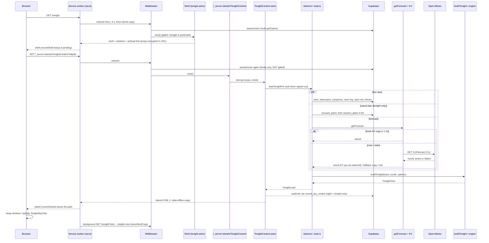

# Research: the Tonight request flow, end to end

**Date**: 2026-10-27T13:30:21+01:00
**Researcher**: Claude Code (claude-opus-5-5), for Rafal Skwara
**Git Commit**: `3104370` (worktree `docs/architect-m4`)
**Branch**: docs/architect-m4
**Repository**: RafalSkwara/Sidereus

## Research Question

How does one `GET /tonight` travel through the system and back? The path runs through `src/middleware.ts`, the page shell `src/pages/tonight.astro` and the `TonightContent` server island (`server:defer`, served at `/_server-islands/*`). It continues through `src/lib/tonight/island.ts`, `load.ts` and `build.ts` (the forecast, the engine, gear, the session plan and sky checks), produces the rendered verdict and tiles, and returns to the browser and the service worker's stored copy.

This is the repo map's risk zone #1 (`context/map/repo-map.md:114-124`). Three parallel strands examined it:
1. an end-to-end trace;
2. test gaps;
3. blast radius (the static graph plus git co-change).

This document describes the current state only and changes no code.

**Legend.** Every finding is tagged:
- **[E] evidence**: read in code or counted with a command, with an anchor;
- **[I] inference**: reasoning from evidence;
- **[U] unknown**: not observable statically, or not checked.

**Scope of the snapshot.** All anchors are at `3104370`. `main` has moved since: PR #245 (stream-error-boundary, merged as `2e028e5`, archived `98ad923`) changes `src/middleware.ts` by +28 lines and adds `src/lib/observability/stream-guard.ts` [E: `git diff --stat 3104370 98ad923 -- src`]. The repo's `CLAUDE.md` on `main` already describes that guard. Middleware findings below are therefore about this snapshot, and section 2.6 notes where #245 changes them.

## Summary

- **The flow is two HTTP requests, not one** [E].
  - The page shell (`tonight.astro`) renders an HTML skeleton and an encrypted island URL. A browser script then fetches `/_server-islands/TonightContent?e&p&s`, and that second request does all the data work.
  - **Both requests run the middleware** and pay a Supabase Auth `getClaims` round trip (`middleware.ts:45`). Only the shell is gated by `PROTECTED_ROUTES`.
  - The island therefore guards itself: `locals.user ? locals.supabase : null` (`island.ts:47`).
- **Data assembly happens in one place.**
  - `loadTonight` (`load.ts:127-243`) runs five list reads in parallel. It then picks the site and telescope, computes one night date, overlaps the saved-plan read with `getForecast`, and calls `buildTonight` [E].
  - `buildTonight` is one function of about 805 lines (`build.ts:690-1494`; the file is 1,494 lines). It holds the verdict, ranking, planets, Moon, sky view, session plan and sky events, each optional block in its own `try/catch` [E].
- **Main technical debt.** Full list in Technical debt.
  1. The `buildTonight` god function.
  2. Option flags declared and copied by hand across three layers.
  3. The island's auth and plan guards are a convention, not a rule.
  4. The `night: "next"` side-effect rule is spread over six server files.
  5. The offline pairing depends on Astro's internal preload-link markup.
  6. An incomplete forecast can be cached and served as fresh for up to an hour.
- **Test gaps.**
  - Strong: `getForecast` and `buildTonight` have strong unit tests. `loadTonight` has a real unit test (`load.test.ts`), which refutes the map's "no unit test reaches the island loaders" for `load.ts`.
  - Missing: `island.ts` is never executed by a unit test. `TonightContent.astro` has no render test. The dashboard island is never replayed signed out. The `night: "next"` isolation (no sky check, no saved-plan read) and `record_sky_verdict`, the only DB write among `.astro` pages and islands, have no asserting test.
- **Blast radius.**
  - `TonightView` changes reach 19 production importers of `build.ts`, plus the 8 islands that read `load.view` untyped [E].
  - `build.ts` co-changes with `build.test.ts` (36 of 49 commits) and with the en/pl catalogues (36 and 37 of 49), more than with any production module [E].
  - Engine and tonight change together per change-id, not per commit: 20 of 23 change-ids that touch engine production code also touch tonight [E]. This answers the map's open question on the 0.41 co-change (section 3.4).

---

## 1. Feature overview

### 1.1 The flow in steps

**A. The shell request**

1. **Browser → service worker.**
   - When a worker controls the page, `GET /tonight` matches `storedPageOf(url)` (`src/sw.ts:704-706`, `src/lib/offline/copies.ts:170-178`).
   - It is served network-first, with a ~4 s timeout before a stored copy answers (`sw.ts:707-737`) [E].
2. **Middleware** (`src/middleware.ts:19-68`):
   - the client-error path bypasses everything (`:22-24`);
   - theme, locale and sky mode come from cookies (`:27-33`), plus the e2e clock seam (`:36-39`);
   - one per-request Supabase client goes on `locals.supabase` (`:41-43`);
   - `await sessionUser(supabase)` sets `locals.user` (`:45`);
   - a signed-in user on an auth entry page is redirected (`:49-51`);
   - `isProtectedPath` sends a signed-out visitor to sign-in with `?next=` (`:53-60`; `/tonight` is in `src/lib/protected-routes.ts:5-15`);
   - after `next()`, `Vary: Cookie, Accept-Language` is appended to any HTML response (`:62-67`) [E].
3. **Page shell** (`src/pages/tonight.astro:16-39`).
   - It resolves the page notices from `?logged`, `?skyChecked` and `?error` to catalogue text, because "inside the server island … Astro.url is the island's own request" (`:19-34`).
   - It reads `?site` and `?telescope` or the remembered cookies (`requestedGear`, `:37`; `requested-gear.ts:11-28`; the cookie is not written for `?night=next`, `:16`) and `?night` (`:39`) [E].
4. **Island placeholder.**
   - With Supabase configured, the shell renders `<TonightContent server:defer siteId telescopeId notice night>` with `TonightSkeleton` as the fallback (`tonight.astro:43-47`).
   - Without Supabase it renders a static sky plus `DatabaseMissing` (`:48-57`) [E].

**B. Astro's server-island mechanism (Astro 7.3.2)**

5. **Island URL.**
   - Astro encrypts the component export, the props and the slots, each with its own context string, into `/_server-islands/<Name>?e=&p=&s=` (`node_modules/astro/dist/runtime/server/render/server-islands.js:132-146`).
   - Under 2048 characters the island is a GET with a `<link rel="preload" as="fetch">` in the head (`:25-29, :147-155`); above that it is a POST (`:164-175`).
   - An inline script fetches the island and swaps it in only on a 200 `text/html` answer (`:159-162, :186-198`) [E].
   - For Tonight the props are two ids, a short notice and `night`, so GET is the expected case [I: URL length not measured].
6. **Island route.**
   - `createEndpoint` decrypts the export, props and slots (400 if tampered), sets `X-Robots-Tag: noindex` and renders the component (`node_modules/astro/dist/core/server-islands/endpoint.js:90-169`) [E].
   - **The user middleware runs on it.** Astro skips middleware only when `skipMiddleware` is set (`core/middleware/astro-middleware.js:35-41`), and only error re-renders set it (`core/errors/default-handler.js:83,97`).
   - But `/_server-islands` is not in `PROTECTED_ROUTES` (`protected-routes.ts:5-15`), so the middleware never redirects an island request [E].

**C. The island: loading**

7. **`TonightContent.astro`** (`:56-92`). It starts the memoised account-plan read without awaiting it (`void getAccountPlan(Astro.locals)`, `:82`; one query per request through a `WeakMap`, `src/lib/account-plan/index.ts:33,49-83`). It then calls `loadTonightFor` with:
   - `withSkyChecks`, `withSkyView`, `withSessionPlan` and `withSkyEvents`;
   - `night`;
   - `readPlanEdits: readPlanEditsFor(Astro.locals)` (`:83-92`) [E].
8. **`loadTonightFor`** (`src/lib/tonight/island.ts:46-71`):
   - signed out or without a database, it returns `null` (`:47-50`);
   - otherwise it adds the Worker wiring: `requestNow(locals)`, `kvForecastCache()`, `FORECAST_BASE_URL` and `islandDefer(locals)` (that is, `locals.cfContext.waitUntil`, `:35-39`);
   - it forces `withSkyChecks` off for `night: "next"` (`:62`) and copies the other options through by hand (`:51-70`) [E].
9. **`loadTonight`** (`src/lib/tonight/load.ts:127-243`):
   - **Parallel lists** (`:140-153`): sites, telescopes, eyepieces, the seen log and, when asked, the open sky checks. Each goes through `load()` (`:114-125`), which catches the error, logs `tonight.<list>` and returns an empty list plus a message key.
   - **Inside one `try`** (`:166-222`):
     - `chooseOwned` picks the requested site and telescope, else the oldest (`:171-172`; `gear-choice.ts:24-29`);
     - `tonightDateForSite` gives the night date, plus one day for `"next"` (`:176-177`);
     - the saved-plan read starts, for tonight only, and never rejects (`:179-188`);
     - `getForecast` is awaited (`:192-200`), then the plan read (`:201-202`), then `buildTonight` (`:203-217`).
   - **Any throw** logs `tonight.build` and sets `tonightError` (`:219-222`). `needsSetup` is computed at `:223` [E].
10. **Saved plan.** `readPlanEditsFor` (`src/lib/session-plans/read.ts:12-20`) returns `null` without a query unless there is a client, a user and `getAccountPlan(locals) === "full"` (`:15-17`). It then reads `session_plans` (`:18`) [E].

**D. The forecast** (`getForecast`, `src/lib/forecast/service.ts:192-243`)

11. **Cache read.**
    - `readCache` reads KV through a 1 s read timeout (`kv-cache.ts:17-33`, `cache.ts:12-31`). A read error or an unusable value is a miss and logs `forecast.cache-read` (`service.ts:164-181`).
    - A stored copy is usable only for the same coordinates (`:203`).
    - It is served without a fetch when it is younger than `FORECAST_FRESH_MS` (1 h, `:35`, `:205-210`) [E].
12. **Miss or stale.**
    - `fetchForecast` calls Open-Meteo with a 3 s timeout (`open-meteo.ts:18,73-83,109-132`).
    - On a 200, the copy is written to KV for 7 days through `defer` (the Worker's `waitUntil`), so the write runs after the response (`service.ts:38, :229-236`).
    - **Incomplete 200** (`:218-228`): `forecast.incomplete` is logged. A usable stored copy that still covers the hours around now is served as `fallback` with no write. Otherwise the incomplete series is stored and returned.
    - **Fetch fails**: `forecast.fetch` is logged and the usable copy is served as `fallback` whatever its age, else `null` (`:237-241`) [E].
13. **Effect on the verdict.**
    - `null` makes the verdict marginal ("no weather data", `src/lib/engine/verdict.ts:80-82`).
    - `fallback` caps `go` at marginal (`verdict.ts:107-109`) [E].

**E. The view model** (`buildTonight`, `src/lib/tonight/build.ts:690-1494`)

14. **Setup** (`:720-768`): the formatter, the engine site, the Bortle threshold, the night date (`options.nightDate`) and `selectionNow` (`now`, or the next night's sunset for `"next"`) [E].
15. **Verdict and seven nights** (`:769-801`).
    - `sevenNightOutlook` is computed once: nights 1-3 get a verdict, nights 4-7 a cloud outlook (`src/lib/engine/outlook.ts:170-192`). Tonight's verdict is `outlook[0]`.
    - Then `explanation` (`:803-819`), `forecastStatus` (`:821`, `forecastStatusOf` at `:631-638`) and the seen summaries (`:823`) are computed.
    - `cardPasses` = go or marginal with a dark window (`:826`) [E].
16. **Ranking** (`:838-890`), only when `cardPasses`.
    - `rankObjects` scores the whole `DEEP_SKY` catalogue (`src/lib/engine/ranking.ts:244-299`) and returns the ranked list, `reachable` and `washedOut`.
    - `build.ts` formats the result into the view [E].
17. **Optional blocks.** Each runs in its own `try/catch` that logs a step and drops only that block:
    - planets (`:892-970`; `tonight.planets` at `:916`, `:967`);
    - Moon (`:981-1069`; `tonight.moon` at `:1019`, `:1067`);
    - sky view (`:1087-1181`, `withSkyView`; `tonight.sky-view` at `:1178`);
    - session plan (`:1185-1422`, `withSessionPlan`; edits applied only for tonight with a passing card, `:1282-1295`; `tonight.session-plan` at `:1419`);
    - sky events (`:1426-1444`, `withSkyEvents`; `tonight.sky-events` at `:1441`).
    - The view is assembled at `:1446-1493` [E].

**F. Rendering and the side effect**

18. **The only database write among `.astro` pages and islands** (ast-grep V13).
    - `recordableVerdict(view)` (`src/lib/sky-checks/record.ts:19-30`) is computed only when `supabase && night === "tonight"` (`TonightContent.astro:112`).
    - `islandDefer(locals)(recordSkyVerdict(...))` then calls the `record_sky_verdict` RPC after the response (`:113-115`; `src/lib/sky-checks/store.ts:74-84`; migration `supabase/migrations/20261003120000_sky_checks.sql:73`) [E].
19. **Render** (`TonightContent.astro:134-278`): nothing at all when `load` is `null` (`:134`). Otherwise, in order:
    - the live sky `TonightSkyView client:load` wrapping `VerdictCard` (`:137-158`), or the static band after a sky-view failure (`:159-188`);
    - `OfflineCopy` (`:190`);
    - the toast or error notice (`:194-205`);
    - the gear cards (`:208-227`) and `TonightTiles` (`:230-234`);
    - `SkyCheckCard` (`:237`), the setup prompts (`:239-266`) and the error and eyepiece notices (`:268-275`) [E].
20. **Back in the browser.** The island HTML replaces the skeleton (`server-islands.js:186-198`) and `TonightSkyView` hydrates [E].

**G. The service worker** (only as far as Tonight touches it)

21. **Pending shell.** After a network shell answer, `recordShell` keeps a pending shell keyed by the island URL it parses from the shell's `<link rel="preload" href="/_server-islands/…">` (`sw.ts:313-348`, `copies.ts:255-264`). A URL with a notice param is never stored (`copies.ts:49,181-183`) [E].
22. **Committing the pair.**
    - The island fetch goes through the worker (`sw.ts:743-757`). `commitIsland` reads the island's `data-offline-copy` metadata (`copyMetaFor`, `copies.ts:276-300`; written by `OfflineCopy.astro:44-59`) and commits shell plus island as a pair (`sw.ts:412-449`).
    - `OfflineCopy` posts no message; the worker reads the metadata from the HTML it proxies [E].
23. **Next-night copy.** For a `tonight` copy, `storeNextCopy` fetches `?site=<id>&night=next` in the background and commits it as `kind: "next"` (`sw.ts:456-461, :471-518`). Copies expire 36 h after the site's last refresh (`copies.ts:44`). The seven `TONIGHT_PAGES` are `copies.ts:15-23` [E].

### 1.2 Sequence diagram

### 1.3 Fan-out: who else rides this path

- **`loadTonightFor` has 8 call sites**, all islands [E]:
  - `TonightContent.astro:83`, `TargetsPageContent.astro:62` (`limit: Infinity`), `PlanPageContent.astro:60`, `EventsPageContent.astro:39`, `NightsPageContent.astro:38`, `PlanetsPageContent.astro:40`, `MoonPageContent.astro:39` (all under `src/components/tonight/`);
  - and `src/lib/finder/load.ts:138-144` (the finder chart, after its own `requireFullPlan` at `:130`).
- **`loadTonight`** has one production caller, `island.ts:51` [E].
- **`buildTonight`** has three production runtime callers: `load.ts:203` and the `/design` fixtures (`src/pages/design.astro:629`, `src/components/design/plan-samples.ts:81`) [E].
- **There are 8 `server:defer` islands** in `src/pages` (`tonight.astro:45`; `tonight/{planets,nights,events}.astro:45`, `moon.astro:46`, `finder.astro:46`, `plan.astro:48`, `targets.astro:53`). Each renders `OfflineCopy` [E].

---

## 2. Technical debt

Ordered by how much each one costs the next change. Each item says what is evidence and what is inference.

### 2.1 `buildTonight` is a god function

- **[E]** One exported function, `build.ts:690-1494` (about 805 lines), in a 1,494-line file. `TonightView` starts at `:457` and the types before the function take about 465 lines (`:88-552`).
  - It computes the verdict, the seven nights, the ranking, planets, Moon, sky view, session plan and sky events in one scope.
  - Its six block-level `try/catch` regions (`:904, :923, :985, :1089, :1186, :1428`, plus a nested one at `:988`) share mutable locals declared before them (`planObjects`, `planPlanets`, `planMoon` at `:829-833`; `axisTracks` at `:1078`).
- **[E]** It is also the top history hub: 49 commits, 16 partner capabilities (`context/map/evidence/1-history.md:135`). Its own test file `build.test.ts` is 1,183 lines.
- **[I]** One phase cannot be tested or changed without constructing the whole input. The session-plan block (`:1185-1422`, about 240 lines) depends on the ranking and sky-view locals, so splitting it needs an explicit intermediate type.

### 2.2 Option flags are declared three times and copied twice by hand

- **[E, ast-grep V7]** The same options exist in three places:
  - `TonightIslandLoad` (`island.ts:10-32`, 11 fields);
  - `LoadTonightInput` (`load.ts:46-84`, 18 fields: those 11 plus the 7 infrastructure inputs `supabase`, `locale`, `now`, `cache`, `forecastBaseUrl`, `defer` and `fetchFn`);
  - `buildTonight`'s inline options type (`build.ts:692-702`, 9 fields).
- **[E, ast-grep V7]** They are copied field by field twice:
  - `island.ts:51-70` builds a 17-property object, 11 of them forwarded one by one from `options`;
  - `load.ts:206-216` builds a 9-property object, 7 forwarded plus the computed `nightDate` and `planEdits`.
  
  The flags are `limit`, `withSkyView`, `withSessionPlan`, `withSkyEvents`, `withPlanCandidates`, `withReachable` and `night`, plus `readPlanEdits`.
- **[E]** The 8 call sites pick different combinations (section 1.3), and no type names a page's combination.
- **[I]** A new optional block costs three type edits plus two copy edits. A flag added to one layer and forgotten in the copy compiles fine, because every flag is optional, and is silently dropped.

### 2.3 Island guards are a convention, not one rule

- **[E]** The middleware sets `locals.user` for island requests but never redirects them (section 1.1, step 6). Each loader therefore guards itself:
  - `island.ts:47` (user);
  - `session-plans/read.ts:15` (user and full plan);
  - `finder/load.ts:130` (`requireFullPlan`).
- **[E, ast-grep V9]** The account plan is asked for at three call sites in one dashboard island request:
  - `TonightContent.astro:82`;
  - `read.ts:15`;
  - `OfflineCopy.astro:41` (`accountPlanForCopy`).
  
  Only the `WeakMap` memo keeps that to one query (`account-plan/index.ts:33`).
- **[E, ast-grep V9; added by verification]** Every one of the six focused islands also calls `getAccountPlan`: `EventsPageContent:37`, `MoonPageContent:37`, `NightsPageContent:36`, `PlanetsPageContent:38`, `TargetsPageContent:60` and `PlanPageContent` via `accountPlanForCopy:57`. The shell's `Topbar.astro:11` reads the plan on every signed-in page.
- **[I]** The memo is keyed by `locals`, which is per request. A Tonight view is therefore two plan queries: one in the shell (Topbar) and one in the island.
- **[E] Docs drift.** Three places say `/_server-islands/*` "is not behind the middleware": `context/foundation/lessons.md:71`, `CLAUDE.md` (finder and session-plan sections) and `src/components/tonight/PlanPageContent.astro:9`.
  - The Astro source says the middleware runs and only the gate is missing. The repo map was already corrected (`3104370`, `repo-map.md:146`).
  - `island.ts:42-44` has it right ("outside PROTECTED_ROUTES").
- **[I]** The risk is a new island that forgets its guard. The rule lives in a lesson and in smoke steps, not in code that a new island inherits.

### 2.4 The `night: "next"` rule is spread over six server files

- **[E, ast-grep V12; corrected from "five files"]** The rule is that the background copy records no sky check, reads no sky checks and reads no saved plan. It is enforced by `night` comparisons in six server files:
  - `island.ts:62` (`withSkyChecks` forced off);
  - `load.ts:177, :180` (date + 1, no plan read);
  - `build.ts:760, :766, :1282, :1284`;
  - `TonightContent.astro:112, :117` (no record, no question);
  - `PlanPageContent.astro:66, :91` (no candidates, no reset);
  - `requested-gear.ts:16, :47` (no cookie).
  
  It is triggered and read on the worker side in `sw.ts:458, :492, :564`, `copies.ts:287, :438, :523, :608` and `page-state.ts:33`. The earlier anchor `build.ts:1413` (`heldEdits`) is not a `night` check.
- **[I]** A new side-effecting feature must remember to check `night` in the right layer. Section 4 (G1) shows that none of these guards is asserted end to end.

### 2.5 The offline pairing parses Astro's internal markup

- **[E]** The worker pairs a shell with its island by regex-parsing the shell's `<link rel="preload" href="/_server-islands/…">` (`copies.ts:255-264`). That link is Astro's internal output (`server-islands.js:147-155`) and exists only for GET islands. `copies.ts:254` notes there is none for a POST island.
- **[I]** Two cases would silently stop offline storage:
  - an Astro upgrade that changes this markup;
  - an island whose encrypted props push the URL past 2,048 characters.
  
  No test runs `islandUrlFromShell` against Astro's real output [U: not exhaustively searched; the e2e offline specs exercise it indirectly].

### 2.6 Error handling hides failures from the page; only the logs show them

- **[E]** Every failure is caught and logged:
  - the five lists (`load.ts:114-125`);
  - the saved plan (`:183-186`);
  - the build (`:219-222`);
  - each optional block (section 1.1, step 17);
  - the forecast outage (`service.ts:237-241`).
- **[E, ast-grep V14]** `planEditsError` is set by `load.ts:185`.
  - `TonightContent.astro` never reads it, by design: the dashboard keeps the suggested plan (comment at `:7-9`). It appears only as `null` in the empty load at `:79`.
  - The plan page reads it (`PlanPageContent.astro:77`).
- **[E]** The island returns 200 with an empty body when signed out (`:134`).
- **[I]** This is consistent and privacy-safe, but which block is missing from a page is visible only in Workers Logs.
- **[E] `main` delta.** At this snapshot the middleware has no boundary for an exception out of `next()` or a stream that errors mid-body. PR #245 on `main` adds one (`stream-guard.ts`, `request.uncaught` and `request.stream` lines, per `CLAUDE.md` on `main`).

### 2.7 An incomplete forecast can be served as fresh for an hour

- **[E]** On an incomplete 200 with no usable stored copy, the series is written to KV with `fetchedAt: now` (`service.ts:209-236`; documented at `:19-21`). The fresh-read path checks only age and coordinates (`:203-210`), not completeness.
- **[I]** For up to `FORECAST_FRESH_MS` (1 h) every Tonight request for that site gets the incomplete series without a refetch. How `buildTonight` grades it is not traced [U].

### 2.8 Smaller items

- **[E, ast-grep V11] Duplicated "no gear" test.** The expression `load.needsSetup || (!sitesError && !site) || (!telescopesError && !telescope)` appears at exactly 7 sites:
  - six `*PageContent.astro` islands: `Events:47`, `Moon:46`, `Nights:45`, `Planets:47`, `Plan:75`, `Targets:70`;
  - `finder/load.ts:150`.
  
  `TonightContent` has its own variant (`addSite` / `addTelescope`, `:123-124`).
- **[E, ast-grep V13] A write inside a GET.** Among `.astro` pages and islands, the only database write is `recordSkyVerdict` at `TonightContent.astro:114`. No `.astro` frontmatter calls `insert`, `update`, `upsert`, `delete` or `rpc` directly. GET API routes (`.ts`) were not in scope. `record_sky_verdict` runs on every dashboard island render for tonight. It is safe because the RPC is idempotent per (user, site, night) (`store.ts:14`). Every extra island fetch costs one RPC, for example the worker's late re-fetch (`sw.ts:666-671`).
- **[E] The shell comment overstates its independence.** `tonight.astro:44` says the shell "responds without waiting on Supabase", but `middleware.ts:45` awaits Auth `getClaims` before any HTML [I: one Auth round trip is on the critical path of both requests].
- **[E] Unguarded duplicate page lists.**
  - `src/pages/offline.astro:19-30` (titles) and `tests/e2e/tonight-phone.spec.ts:41-49` (a literal `TONIGHT_PAGES`) are not compared with `copies.ts:15-23` by any test found.
  - `TONIGHT_NAV` is compared (`navigation.test.ts:9-10`).
  - No drift exists at HEAD.

---

## 3. Blast radius

### 3.1 Static fan-in at HEAD

Counted as distinct importing files, with `rg` on the import specifiers plus relative imports [E]:

| Module | Importers | Production | Notes |
|---|---|---|---|
| `island.ts` | 8 | 8 | the 7 Tonight islands + `finder/load.ts:26`; no test imports it |
| `load.ts` | 10 | 6 | most import helpers or types (`logHref`, `finderHref`, `TonightLoad`, `PlanEditsReader`); only `island.ts` calls `loadTonight` |
| `build.ts` | 24 | 19 | 12 `src/components/tonight/*` (type-only), `design.astro`, 2 design samples, `finder/load.ts`, `sky-checks/record.ts`, `load.ts`, `plan-editor-view.ts` |
| `TonightView` type | 12 | 7 | plus field-level readers that never import the type: the 8 islands read `load.view.*` through the return value |

- **[I]** The import graph undercounts a `TonightView` field change: `astro check` reaches all 8 islands, `rg` on the type name does not.
- **[E]** `middleware.ts` imports nothing from `src/lib/tonight` (`:1-16`). It reaches the flow only through `Astro.locals` (`src/env.d.ts`) and `PROTECTED_ROUTES`. This runtime wiring is invisible to the graph, as the map's `graph_coverage` already says.

### 3.2 Static fan-out

- **[E] `build.ts`** (20 modules, `:1-77`):
  - the engine barrel (about 40 names);
  - the forecast type, gear, targets, observations target options, the catalogue and common names;
  - i18n, `logFailure`;
  - the session plan (`plan-edits`, `plan-order`, `plan-window`, `session-plan`), `sky-events`, `sky-view` (type), `moon-disc`, `format` and preferences.
- **[E] `load.ts`** (17 modules, `:7-30`): the engine, `forecast/service`, `gear/store`, `observations/store`, `sky-checks/{pending,store}`, `logFailure`, `build`, `gear-choice` and `tonight-date`.
- **[E]** `load.ts` does not import the account plan or the session-plans store. The saved plan arrives as an injected `PlanEditsReader`.
- **[E]** `island.ts` alone adds `cloudflare:workers` (via `kv-cache.ts`), `astro:env/server` and `@/lib/clock`.

### 3.3 Git co-change (812 non-merge commits, `git log --follow --no-merges`)

| File | Commits | Strongest partners (shared commits / ratio) |
|---|---|---|
| `build.ts` | 49 | `build.test.ts` 36 (.73); **en.ts 36 / pl.ts 37** (.73/.76); `format.ts` 20 (.41); `TonightContent` 19 (.39); `design.astro` 18 (.37); `load.ts` 15 (.31); `engine/index.ts` 9 (.18) |
| `load.ts` | 21 | `build.ts` 15 (.71); `build.test.ts` 10; `TonightContent` 9; `island.ts` 8 (.38); `load.test.ts` 8 |
| `island.ts` | 9 | `load.ts` 8 (.89); `build.ts` 7 (.78); `design.astro` 6 |
| `TonightContent.astro` | 52 (46 under the current name) | `build.ts` 22 (.42); `tonight.astro` 17; `VerdictCard` 17; `TonightSkeleton` 17; `format.ts` 16 |
| `tonight.astro` | 19 | `TonightContent` 11 (.58); `GearShell` 7 |
| `forecast/service.ts` | 7 | `service.test.ts` 7; `load.test.ts` 4; `open-meteo.ts`, `kv-cache.ts`, `engine/verdict.ts` 3 each |

[E] The partner lists exclude `context/`, `*.md` and the message catalogues; the catalogues are counted separately in the `build.ts` row. Only 4 of the 49 `build.ts` commits are mega-commits (≥30 files), so these ratios are not an artefact of bulk commits.

### 3.4 The map's open question: engine without tonight (0.41)

- **[E] Per commit.** 45 commits touch engine production files. 24 of them (53%) touch no tonight path.
- **[E] Per change-id.** 23 change-ids touch engine production code, and 20 of them touch tonight in some commit. In 17 of the 24 engine-only commits, a later commit of the same change-id wires Tonight. The 3 change-ids that never touch tonight are `sites-and-gear-management`, `small-scope-galaxies` and `verified-ephemeris-core`.
- **[I]** The low 0.41 is phasing (engine first in p1/p2, the consumer later), not independent evolution.
- **[I]** `small-scope-galaxies` is the case the map worries about: a rule change that alters Tonight's wording with no Tonight edit. It was guarded by the engine's own tests (`small-scope.test.ts`, per `CLAUDE.md`), not by a Tonight test.

### 3.5 Seams outside the import graph

| Seam | Where | Change rule |
|---|---|---|
| Tables read | `sites`, `telescopes`, `eyepieces` (`20260924120000_sites_and_gear.sql`), `observations` (5 migrations, last `20261006200000`), `sky_checks` (`20261003120000`), `session_plans` (`20261014120000`), `account_plans` (`20261009120000`) | a new column or table needs a migration, `npm run db:types`, and `tests/db/tables.ts` / `structure.test.ts` [E per `CLAUDE.md` + files] |
| The one write | RPC `record_sky_verdict` (`20261003120000_sky_checks.sql:73`; `sky-checks/store.ts:78`) | a new migration; `tests/db/sky-checks.test.ts` |
| KV + env | `FORECAST_CACHE` binding (`wrangler.jsonc`), `FORECAST_BASE_URL` (`astro.config.mjs:17-22`), read only in `kv-cache.ts` and `island.ts:5,58` | `npm run cf:types`; e2e and capture point the URL at `tests/e2e/forecast-fixture.mjs` |
| Failure steps | 13 `tonight.*` steps in `FAILURE_STEPS` (`src/lib/observability/log-failure.ts:26-38`) | a new block needs a step; `silent-catch-guard.test.ts` |
| Message keys | `load.ts:33-38` (6 keys); en + pl lockstep (`satisfies Messages`, parity test) | the 36-37 of 49 `build.ts` commits that edit en/pl are this seam |
| Offline contract | `OfflineCopy` `data-offline-copy` in all 8 islands; `TONIGHT_PAGES` (`copies.ts:15-23`) | a new page goes into `TONIGHT_PAGES` (at the end) + `TONIGHT_NAV` + `offline.astro` titles |
| HTTP checks | `scripts/smoke.mjs` pins island names `FinderContent`, `TargetsPageContent`, `PlanPageContent` (`:134, :139, :182`) | renaming those components breaks smoke |

### 3.6 If you change X, also touch Y

| Change | Must touch [E] | Likely [I] |
|---|---|---|
| Add a field to `TonightView` | `build.ts`, `build.test.ts`, the consuming component, en + pl if shown | `design.astro` / `plan-samples.ts` (runtime `buildTonight`), `OfflineCopy` if offline metadata, e2e Tonight specs |
| Add an optional block or flag | `build.ts` options, `LoadTonightInput`, `TonightIslandLoad`, the two copies (`island.ts:51-70`, `load.ts:206-216`), the asking island, a `FAILURE_STEPS` entry | `load.test.ts`; a message key |
| Add a list read to `loadTonight` | `load.ts` `Promise.all` + `load()` + `TonightLoad`, a store, a `tonight.*` step | an injected reader if it is plan-gated (keeps `load.ts` free of the account plan) |
| Add a `/tonight/*` page | page + `*PageContent` island with its own guard + `OfflineCopy`, `TONIGHT_PAGES`, `TONIGHT_NAV` | `offline.astro` titles, `tonight-phone.spec.ts` literal, quick-nav icon map and `tonight.quickNav` keys, smoke if gated |
| Change the forecast shape | `service.ts` + test, `load.test.ts`, `build.ts` + tests, engine `verdict.ts` / `types.ts` | `forecast-fixture.mjs`; a cache-key bump, because KV holds 7-day-old shapes [U: whether `readCache`'s zod parse treats an old shape as a miss was not checked] |
| Change the verdict rule | engine + its tests, en + pl if tones change | `VerdictCard`, `recordableVerdict` and the RPC's headline contract, `forecast-honesty` / `visibility-invariants` tests, re-measure `VERDICT_MIN_HEIGHT_CLASS` |

---

## 4. Test gaps

Static analysis only: no coverage provider is installed (`@vitest/coverage-*` absent) and no test was run.

### 4.1 What is covered well [E]

- **`getForecast`**: every branch has a direct unit test in `src/lib/forecast/service.test.ts` (21 `it` + 1 `it.each` of 3):
  - fresh `:33`, stale `:45`, miss `:58`, coordinates changed `:68`;
  - outage with a copy `:76`, outage without one `:87`;
  - deferred write `:107-142`, incomplete 200 `:182-257`, cache errors `:375-441`.
  
  `kv-cache.test.ts`, `open-meteo.test.ts` and `degraded-forecast.test.ts` cover the rest of the forecast module.
- **`buildTonight`** (`build.test.ts`, 40 `it`, plus `forecast-honesty.test.ts`, `visibility-invariants.test.ts`, `night-boundaries.test.ts`):
  - forecast null / fallback / fresh;
  - each optional block and its failure drop (`:1095-1181`);
  - `planEdits` and `night: "next"` (`:787-861, :1032-1093`).
- **`loadTonight`** (`src/lib/tonight/load.test.ts`, 5 `it` + 1 `it.each` of 4). It imports and runs the real `loadTonight` (`:9`); only the store lists and a build-throw hook are mocked (`:19-55`). It covers:
  - each list failure (`:132-152`) and the sky-checks failure (`:154-167`);
  - the plan-edits failure (`:169-192`);
  - the single night date (`:93-106`);
  - the build throw (`:194-205`);
  - the forecast outage (`:86-91`).
- **Middleware** (`src/lib/auth/middleware.test.ts`, 4 `it`): client-error bypass, protected redirects, Auth down, `Vary`.
- **Offline pure rules**: `copies.test.ts`, about 45 `it`.
- **The RPC's semantics**: `tests/db/sky-checks.test.ts:94-165`.

### 4.2 Verdict on the map's claim

The map says: "The island loaders (`island.ts`, `load.ts`) have no unit test reaching them and rely on e2e and smoke" (`repo-map.md:120`, from `evidence/3-structure.md:118`).

**Refined.**
- For `load.ts` it is **refuted** [E]: `load.test.ts` runs `loadTonight` for real.
- For `island.ts` it is **confirmed** [E]. The only unit-test mention is `src/lib/finder/load.test.ts:28`, which replaces the module with `vi.mock`, so `loadTonightFor` and `islandDefer` never execute in a unit test. A mock helper for `astro:env` and `cloudflare:workers` already exists (`src/lib/test-support/virtual-modules.ts:15-22`) [I: a unit test is feasible].
- "Rely on e2e and smoke" is only partly true. Those layers run the happy path, but no assertion targets `island.ts:62` or `islandDefer`.

### 4.3 Gaps, ranked by risk [anchors E, ranking I]

1. **G1: `night: "next"` isolation is untested end to end.**
   - The guards at `island.ts:62`, `load.ts:177,180` and `TonightContent.astro:112,117` have no asserting test.
   - No e2e or smoke step references a `next` copy (`sw.ts:471-518` is exercised only through the pure `needsNextCopy` / `chooseCopy` tests).
   - A regression would record a sky check for tomorrow on every background fetch.
2. **G2: the dashboard island is never replayed signed out.** `smoke.mjs` replays the Targets (`:784-790`) and Plan (`:805-811`) islands, both through the same `island.ts:47` guard, but not `TonightContent`. That island starts a plan read (`:82`) and holds the only write.
3. **G3: the only write from a GET has no asserting test.**
   - `recordableVerdict` has 1 of 3 branches tested: `record.test.ts:8-18` covers no dark start. The `noDarkness` headline (`record.ts:26-28`) and the happy return (`:29`) are untested.
   - Nothing asserts that the dashboard calls the RPC or skips it.
4. **G4: the failure UI is never rendered.**
   - The loader's error keys are unit-tested.
   - Their rendering is not: `TonightContent.astro:220-225, :268, :273` and the static band after a sky-view failure (`:159-188`; `data-sky-mode-frame="static"` has 0 hits in `tests/e2e`). There is no component render harness in the repo.
5. **G5: forecast degradation is unit-only.**
   - The e2e fixture is all-clear (`tests/e2e/forecast-fixture.mjs`).
   - The smoke step that claims "renders even when the forecast is unreachable" asserts only the shell's 200 (`smoke.mjs:438-439`); the island is not fetched there.
6. **G6: the setup and gear-choice branches of `loadTonight` have no unit test.**
   - Requested ids (`load.ts:171-172`), `needsSetup` (`:223`) and `multipleSites` / `multipleTelescopes` (`:235-236`) are e2e-only (`telescope-selector.spec.ts:92-187`).
   - The `addSite` prompt (`TonightContent.astro:248`) is reached by no test.
7. **G7: the service worker's next-night store and `data-kind="next"` have no test of their own;** they are e2e-incidental at most.
8. **G8: small helpers with no unit test:**
   - `readPlanEditsFor` (strong smoke coverage of its gate);
   - `pickTonightNotice` (`notice.ts:14`), `selectorKind` (`gear-choice.ts:32`), `openSkyChecksSince` (`pending.ts:25`);
   - `finderHref` (`load.ts:268`), `islandDefer`;
   - the middleware's `supabase === null` branch and its non-HTML `Vary` case.

---

## 5. Verification of structural claims (ast-grep)

Lesson m4l3-2. Every structural claim above (call-site counts, "only here", "always via X", and repeated call shapes) was re-checked with **ast-grep 0.51.0**. Every zero was backed with plain `rg`, to tell a real absence from a bad pattern. Run on `3104370`, 2026-10-27.

**Method and tool limits.**
- **Astro.** ast-grep has no Astro grammar. Each `.astro` file's frontmatter was therefore mirrored into a `.ts` file with the same line numbers: the fences were blanked and the template dropped (110 files; `evidence/extract-fm.sh`, run as `extract-fm.sh $SP/astro-fm $(git ls-files "src/**/*.astro")`; queries ran through `evidence/sg.sh`). Matches were mapped back to the `.astro` path.
- **Template-only claims.** `server:defer` and `<OfflineCopy>` live outside the frontmatter, so they were checked with `rg` only.
- **Call counts.** A count is distinct `file:line` pairs of the pattern's match.
- **Patterns** use `-l ts`; tests are included unless the claim says "production".

| # | Claim (section) | ast-grep pattern | Result | Verdict |
|---|---|---|---|---|
| V1 | `loadTonightFor` has 8 call sites, all islands (1.3) | `loadTonightFor($$$)` | 8: `TonightContent:83`, `Targets:62`, `Plan:60`, `Events:39`, `Nights:38`, `Planets:40`, `Moon:39` (all `*PageContent.astro`), `finder/load.ts:138` | **confirmed** |
| V2 | `loadTonight` has one production caller (1.3) | `loadTonight($$$)` | `island.ts:51` + the test helper `load.test.ts:66` | **confirmed** |
| V3 | `buildTonight` has 3 production runtime callers (1.3) | `buildTonight($$$)` | 47 call lines: production `load.ts:203`, `plan-samples.ts:81`, `design.astro:629`; the other 44 in 5 test files | **confirmed** |
| V4 | `buildTonight` has six block-level `try/catch` (2.1) | `try { $$$ } catch ($E) { $$$ }` in `build.ts` | 7: `:904, :923, :985, :988, :1089, :1186, :1428`; `:988` is nested in `:985` | **refined** (anchors corrected: six + one nested) |
| V5 | 7 `logFailure` sites in `build.ts`, 3 in `load.ts` (1.1 step 17, 2.6) | `logFailure($$$)` | `build.ts:916, 967, 1019, 1067, 1178, 1419, 1441`; `load.ts:122, 184, 220` | **confirmed** |
| V6 | `loadTonight` reads 5 lists in one `Promise.all`, each via `load()` except the optional sky checks' empty branch (1.1 step 9) | `load($STEP, $$$)`; `await Promise.all([$$$E])` | 5 `load(` calls at `load.ts:141-147`; one `Promise.all` at `:140` with 5 elements (the 6th match is a comment) | **confirmed** |
| V7 | Option flags declared three times, copied twice by hand (2.2) | `interface $N { $$$P }`; `loadTonight({ $$$P })`; `buildTonight($I, $L, { $$$P })` | declarations of 11 / 18 / 9 fields; copies of 17 properties (11 forwarded) and 9 (7 forwarded) | **refined** (exact counts added; the options anchor moved to `build.ts:692-702`) |
| V8 | Only `island.ts` holds the user guard `locals.user ? locals.supabase : null` (2.3) | `$L.user ? $L.supabase : null` | 1: `island.ts:47` | **confirmed** |
| V9 | The plan is read at three call sites per dashboard island (2.3) | `getAccountPlan($$$)`, `accountPlanForCopy($$$)`, `requireFullPlan($$$)` | dashboard: `TonightContent:82`, `read.ts:15`, `OfflineCopy:41`; also all six focused islands, `Topbar.astro:11` (shell, every signed-in page), and `requireFullPlan` at `finder/load.ts:130`, `finder.astro:38` and the two plan POST routes | **refined** (Topbar's shell read and the focused islands' reads added) |
| V10 | The island guards live in `island.ts`, `read.ts`, `finder/load.ts` (2.3) | V8 + `requireFullPlan($$$)` + `readPlanEditsFor($$$)` | `readPlanEditsFor` is called only at `TonightContent:91` and `PlanPageContent:65` | **confirmed** |
| V11 | The "no gear" expression is duplicated in 6 islands + `finder/load.ts` (2.8) | `$L.needsSetup \|\| (!$SE && !$S) \|\| (!$TE && !$T)` | 7 sites, listed in 2.8; the looser `$A.needsSetup \|\| $$$B` finds the same 7 | **confirmed** |
| V12 | The `night: "next"` rule is spread over five files (2.4) | `$X === "next"`, `$X !== "next"`, `$X === "tonight"` | 23 matches; server side in 6 files (incl. `PlanPageContent.astro`, `requested-gear.ts:47`), worker side in `sw.ts`, `copies.ts`, `page-state.ts`; `build.ts:1413` has no `night` check | **refuted as stated, corrected** to six server files |
| V13 | `record_sky_verdict` is the one write from a GET (1.1 step 18, 2.8) | `$C.rpc("record_sky_verdict", $$$)`; `recordSkyVerdict($$$)`; `$C.insert/update/upsert/delete/rpc($$$)` over all `.astro` frontmatter | the RPC only at `sky-checks/store.ts:78` (+ `record-transport.test.ts:85`); `recordSkyVerdict` in production only at `TonightContent:114`; 0 direct writes in `.astro`. **Zero backed by rg**: `rg "\.(insert\|update\|upsert\|delete\|rpc)\(" --glob '*.astro'` gives 0; `rg "Store\.(record\|save\|…)\(\|recordSkyVerdict\("` over `.astro` gives only `TonightContent.astro:114` | **refined** (scoped to `.astro` pages and islands; GET `.ts` routes not checked) |
| V14 | `TonightContent` never reads `planEditsError` (2.6) | `$X.planEditsError`, then `$X?.planEditsError` | the first pattern finds only tests; the optional-chain pattern finds `PlanPageContent.astro:77`; `rg` confirms TonightContent has only the `null` initialiser `:79` | **confirmed for TonightContent; refined** (the plan page reads it). Pattern lesson: `a.b` does not match `a?.b` |
| V15 | `islandDefer` / `waitUntil` only in the island wiring (1.1 step 8) | `islandDefer($$$)`; `$L.cfContext.waitUntil($$$)` | `islandDefer`: `island.ts:59`, `TonightContent:114`; `waitUntil`: `island.ts:37` only | **confirmed** |
| V16 | Only `kv-cache.ts` (and `rate-limit.ts`) import `cloudflare:workers` (3.2, CLAUDE.md) | `import $$$ from "cloudflare:workers"` | 2: `forecast/kv-cache.ts:1`, `observability/rate-limit.ts:1` | **confirmed** |
| V17 | No unit test executes `island.ts`; only `finder/load.test.ts` mocks it (4.2) | import pattern over `@/lib/tonight/island`; `vi.mock("@/lib/tonight/island", $$$)` | 8 importers, 0 tests (`rg` cross-check: 8 files); 1 mock at `finder/load.test.ts:28` | **confirmed** |
| V18 | One unit test imports `loadTonight` (4.2) | `import { $$$A } from "$M"`, filtered by name | `island.ts:8` and `load.test.ts:9` only; `load.test.ts` has 3 `vi.mock` calls (`:28, :38, :44`), the stores and the build hook | **confirmed** |
| V19 | Fan-in: `island.ts` 8, `load.ts` 10 (4 tests), `build.ts` 24 (5 tests), `TonightView` 12 (3.1) | `import $$$ from "$M"` / `import { $$$A }` / `import type { $$$A }` | 8 / 10 (4) / 24 (5) / 12 (`import { … }` alone finds 6; with `import type { … }`, 12; `rg` multiline also 12) | **confirmed**. Pattern lesson: `import type` needs its own pattern |
| V20 | 13 `tonight.*` steps in `FAILURE_STEPS` (3.5) | `"$S"` string literals in `log-failure.ts` | 13; `rg -c '"tonight\.'` gives 13 | **confirmed** |
| V21 | `middleware.ts` imports nothing from `src/lib/tonight` (3.1) | `import $$$ from "$M"` in `middleware.ts` | 9 specifiers, none under `@/lib/tonight` | **confirmed** |
| V22 | `/_server-islands` is not in `PROTECTED_ROUTES`; the middleware awaits `sessionUser` once (1.1 steps 2, 6) | `"$S"` in `protected-routes.ts`; `await sessionUser($$$)` | 9 routes, no `_server-islands` (`rg`: 0 hits); `await sessionUser` at `middleware.ts:45` only in production | **confirmed** |
| V23 | `recordableVerdict` has 1 of 3 branches tested (4.3 G3) | `recordableVerdict($$$)` | one test call, `record.test.ts:10` (the no-dark-start case); production `TonightContent:112` | **confirmed** |
| V24 | 6 message-key constants in `load.ts` (3.5) | `const $N: MessageKey = $V` | 6 at `load.ts:33-38` | **confirmed** |
| V25 | 8 `server:defer` islands, each renders `OfflineCopy` (1.3) | none (template, no Astro grammar) | `rg "server:defer" src/pages`: 8; `rg -l "<OfflineCopy"`: the 8 island components (7 Tonight + `FinderContent`) | **confirmed (rg only)** |

**Tally:** 25 claims checked.
- 19 confirmed, V25 by `rg` only;
- 5 refined, with the report corrected in place: V4, V7, V9, V13 and V14 (V14 is confirmed for TonightContent and refined for the plan page);
- 1 refuted as stated and corrected: V12, the "five files" count.

Three pattern pitfalls surfaced. In each, a first zero or undercount was a pattern problem, not an absence:
- optional chaining (V14);
- `import type` (V19);
- a comment counted inside a `$$$` list (V6).

---

## Code References

- `src/middleware.ts:41-45` — per-request Supabase client and `sessionUser` (both requests)
- `src/middleware.ts:53-60` — the only gate; `/_server-islands` is not in `src/lib/protected-routes.ts:5-15`
- `src/pages/tonight.astro:43-47` — `<TonightContent server:defer …>` with `TonightSkeleton` fallback
- `node_modules/astro/dist/runtime/server/render/server-islands.js:132-155` — encrypted island URL and preload link
- `src/lib/tonight/island.ts:46-71` — `loadTonightFor`: self-guard, Worker wiring, option copy
- `src/lib/tonight/load.ts:127-243` — `loadTonight`: parallel lists, choice, night date, forecast, build
- `src/lib/forecast/service.ts:192-243` — `getForecast`: fresh / stale / incomplete / outage
- `src/lib/tonight/build.ts:690-1494` — `buildTonight`
- `src/components/tonight/TonightContent.astro:82-117` — plan read, load, `record_sky_verdict`, sky question
- `src/lib/sky-checks/store.ts:74-84` — the RPC call
- `src/components/tonight/OfflineCopy.astro:44-59` — the offline metadata the worker parses
- `src/sw.ts:412-461, :471-518` — `commitIsland`, `storeNextCopy`
- `src/lib/offline/copies.ts:15-23, :255-264, :276-300` — `TONIGHT_PAGES`, island-URL parsing, copy metadata

## Architecture Insights

- **A split render with two trust boundaries.** The shell is gated by the middleware; the island is authenticated by the same middleware but authorised only by its own loader. Every paid or private read on an island must re-check the user and the plan. Today that is three hand-written guards, held by a lesson and by smoke replays.
- **Framework-free core, wiring at the edge.** `load.ts` and `build.ts` are free of Astro and Cloudflare: the KV cache, `waitUntil`, the base URL and the plan reader are injected by `island.ts`. That is why `load.ts` is unit-testable and `island.ts` is not tested. It is a deliberate seam (`load.ts:4-5`, `island.ts:1-3`).
- **Fail soft, log once.** Each data source degrades to an empty list, `null` or a `fallback` flag, with exactly one `logFailure` step from a closed vocabulary. The page never shows an error page for a partial failure.
- **One view model, many pages.** `TonightView` is a superset; each island opts into blocks with flags. That keeps every page consistent for the same night and setup (`load.ts:1-3`), at the cost of the flag plumbing in section 2.2.

## Historical Context (from prior changes)

- `context/archive/2026-10-04-tonight-dashboard/plan.md`: introduced the dashboard plus focused `/tonight/*` pages, each its own `server:defer` island, through `loadTonightFor`.
- `context/archive/2026-10-05-offline-night-plan/plan.md`: introduced the shell plus island pair storage and the `?night=next` background copy that section 2.4 tracks.
- `context/archive/2026-10-07-testing-forecast-honesty/research.md`: background to `forecast-honesty.test.ts` (section 4.1).
- `context/archive/2026-10-15-error-visibility`: the `logFailure` steps used throughout.
- **Historical claim "`/_server-islands/*` is not behind the middleware"** (`lessons.md:71`, `CLAUDE.md`, `PlanPageContent.astro:9`): **partial**.
  - Correct: the island is not behind the gate, and a replayed URL without a session gets nothing.
  - Contradicted: the middleware does run and does set `locals.user`. The rule the lesson draws from it (check the plan in the loader) still holds.

## Related Research

- `context/map/repo-map.md` (risk zone 1, the accounts watch item) and `context/map/evidence/1-4`: the L2 map this research deepens.
- `context/archive/2026-10-04-tonight-nightfall/research.md`, `context/archive/2026-10-15-ui-tonight-nav/research.md`: UI-level research on the same pages.

## Open Questions (unknowns)

- **[U] Runtime cost.** The real latency of the two `getClaims` calls, the 1 s KV read and the 3 s Open-Meteo fetch per Tonight view; whether the worker's ~4 s timeout fires in the field. No production traces were available.
- **[U] `waitUntil` completion.** Whether the deferred KV write and `record_sky_verdict` always finish within Cloudflare's post-response limits.
- **[U] Incomplete forecasts.** How `buildTonight` grades an incomplete series served as fresh (section 2.7), and how often production sees one (`forecast.incomplete` lines).
- **[U] Old KV shapes.** Whether `readCache`'s parse treats a 7-day-old KV entry of an older shape as a miss, which matters for a forecast-shape change.
- **[U] Island URL length.** Whether any real island exceeds 2,048 characters and becomes a POST, which would break offline pairing (section 2.5).
- **[U] `Cache-Control`.** The `Cache-Control` of shell and island responses was not inspected; only `Vary` was.
- **[U] Branch coverage numbers.** Not available without a coverage provider. The gaps above are from reading tests: titles for `build.test.ts`, `copies.test.ts` and `forecast-honesty.test.ts`, and full bodies for `load.test.ts`, `record.test.ts`, `pending.test.ts` and `middleware.test.ts`.
