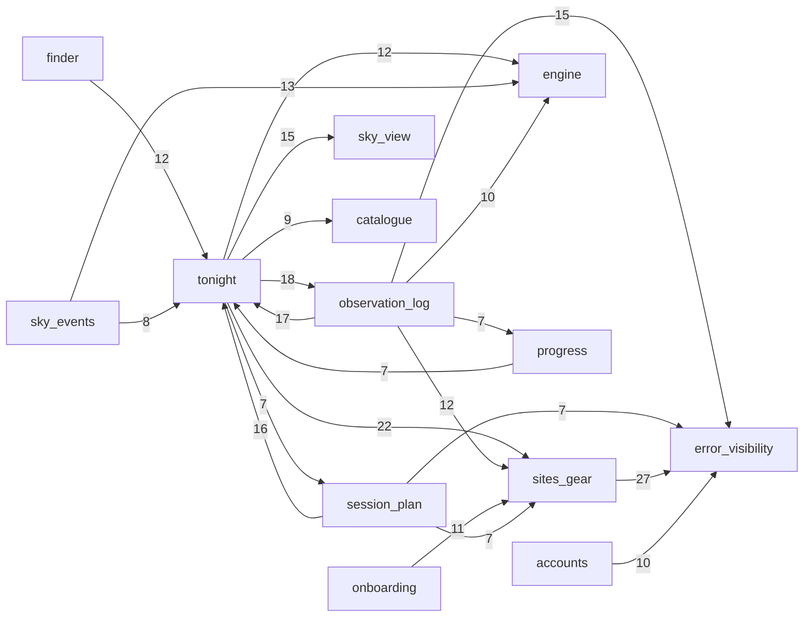

# Evidence: structure

Source: the static import graph of the tracked TypeScript/Astro code at HEAD `321427c`, folded to the 18 capabilities in `context/map/.work/capabilities.tsv` (through `graph-metrics.mjs --modules` and `attribute.py`). Raw data: `context/map/.work/edges-ts*.csv|tsv`, `fold-*`, `metrics-*`, `reach-summary.tsv`. Labels: **evidence** (from a command in this run), **inference** (my reading of evidence), **unknown** (outside what the graph can see).

## Graph sources

| Language | Source | Level | Confidence | Scope | Blind spots |
|---|---|---|---|---|---|
| TypeScript / TSX / Astro | the project's own TypeScript compiler API (`node_modules/typescript` 6.0.3, `ts.createSourceFile` + AST walk; helper `context/map/.work/extract-edges.mjs`). `.astro` files: frontmatter (between the leading `---` fences) and every `<script>` block parsed as TS (110 files, 124 chunks, 1 `is:inline` script) | 2 (toolchain) | **high** for static edges | 548 files parsed: 352 production (`src/**`, `scripts/**`), 196 tests (unit, e2e, db). 0 unresolved local specifiers; `@/` alias and relative paths resolved to files; 42 external specifiers dropped (packages, `node:*`, `astro:*`, `cloudflare:workers`) | no type checker (type-only detection is syntactic, but reliable: `verbatimModuleSyntax: true` in `astro/tsconfigs/base.json`, so a type import must be written `import type`); Astro template usage counted only through its import; runtime wiring through `Astro.locals`, server islands, env bindings and the service-worker build (see Unknowns) |
| Python (4 oracle scripts `scripts/*-reference.py`) | `git grep` of import lines | 4 (fallback) | high for "no in-repo imports" | imports are stdlib, `skyfield`, `numpy` only | their coupling to the app is data, not code: they write JSON fixtures that tests read (`window-reference.test.ts` reads `fixtures/skyfield/`) → **unknown** to the graph |

Level 1 (evidence): the repo has no graph tool or import-boundary lint rule (`eslint.config.js` has no `no-restricted-imports` / boundaries rule). It has **regex import guards in tests**, which are boundary enforcement, not graph sources: `src/components/island-imports.test.ts` (allow-lists for `MoonTimeSlider`, `TonightSkyView`, `src/lib/sky-view/*`; Fact family kept out of islands), `src/lib/observability/client/client-imports.test.ts` (client modules free of server code; worker never imports the client barrel), `src/lib/engine/purity.test.ts` (content grep for clock/env/network/fs in the engine; moon-disc may import only `engine/parameters`), plus `scripts/build-sw.mjs` failing the build on `finder-stars` or map assets in `dist/client`. Note: the island guard covers named islands and `sky-view`, not every `.tsx` island (evidence: its `ISLANDS` / `SKY_SOURCES` lists).

Excluded from the production graph (evidence): tests (`*.test.*`, `*.spec.*`, `tests/**`, `src/lib/test-support/**`, `src/lib/engine/fixtures/**`) → `edges-ts-tests.csv` (608 edges); generated targets (`src/lib/database.types.ts`, catalogue / gear-catalogue / `scripts/data` JSON) → `edges-ts-generated.csv` (30 edges, 15 runtime JSON loads + 15 type-only `database.types` imports).

**Production edge counts (evidence):** 1,285 runtime, 252 type-only, 8 build (all inside `scripts/`, build tooling → `scripts/lib`), 2 production dynamic `import()` (`LocationPicker.tsx → map-panel.tsx`, `finder-stars.ts → finder-stars.json`). Capability attribution: 0 unmapped files; 346 of 352 production files are in the graph; 6 isolates: `src/pages/dashboard.astro` (redirect only), `src/lib/catalogue/vmag-colour-pins.ts` (imported by tests only), `scripts/{account-plan,build-sw,capture-landing,smoke}.mjs` (no internal imports).

## Capability graph

Runtime, folded by `capabilities.tsv` (evidence; `graph-metrics.mjs --modules … --kind runtime`). Ca/Ce count distinct capabilities. "excl. /design" drops the dev-only kitchen sink `src/pages/design.astro` + `src/components/design/**` (Ce 78 on its own; mechanical). File edges = runtime file-level edges (from `fold-ts-pairs.tsv`).

| Capability | Prod files | Ca | Ce | Instability | Instability excl. /design | Intra runtime file edges | Cross-cap runtime file edges in / out (excl. /design) |
|---|--:|--:|--:|--:|--:|--:|--:|
| shared | 46 | 12 | 15 | 0.56 | 0.33 | 94 | 323 / 10 |
| tonight | 46 | 11 | 12 | 0.52 | 0.55 | 78 | 69 / 169 |
| sites-gear | 42 | 9 | 7 | 0.44 | 0.47 | 72 | 64 / 105 |
| accounts | 20 | 8 | 5 | 0.38 | 0.38 | 21 | 20 / 39 |
| engine | 24 | 11 | 2 | 0.15 | 0.17 | 67 | 50 / 2 |
| error-visibility | 15 | 11 | 2 | 0.15 | 0.15 | 20 | 76 / 2 |
| observation-log | 31 | 6 | 7 | 0.54 | 0.58 | 48 | 28 / 114 |
| offline | 11 | 5 | 8 | 0.62 | 0.62 | 5 | 13 / 17 |
| session-plan | 23 | 3 | 10 | 0.77 | 0.83 | 25 | 8 / 76 |
| finder | 13 | 3 | 9 | 0.75 | 0.82 | 15 | 2 / 45 |
| progress | 28 | 3 | 7 | 0.70 | 0.78 | 32 | 8 / 34 |
| sky-events | 10 | 3 | 7 | 0.70 | 0.78 | 9 | 4 / 45 |
| sky-view | 16 | 7 | 3 | 0.30 | 0.30 | 13 | 28 / 15 |
| onboarding | 7 | 1 | 7 | 0.88 | 0.88 | 6 | 1 / 41 |
| catalogue | 13 | 7 | 0 | 0.00 | 0.00 | 0 | 19 / 0 |
| forecast | 5 | 1 | 1 | 0.50 | 0.50 | 2 | 2 / 2 |
| platform | 2 | 1 | 0 | 0.00 | 0.00 | 0 | 1 / 0 |

Every capability except catalogue, platform, forecast and error-visibility imports `shared` (evidence, runtime file edges into shared: sites-gear 73, tonight 71, observation-log 51, accounts 26, session-plan 24, onboarding 18, sky-events 17, progress 16, sky-view 11, finder 9, offline 6). The diagram leaves those edges out and keeps cross-capability edges of ≥ 7 runtime file edges (21 of 93 pairs; `context/map/.work/cap-runtime-diagram.mmd`; full graph in `cap-runtime.mmd`).

## Blast radius per capability

Transitive reach = production files (and pages/routes among them) that reach the contract through runtime imports (`--reaches`, evidence; out of 332 runtime nodes, 48 page/route files). Static only: the Supabase client and the user reach features through `Astro.locals` (see Unknowns).

| Capability (criticality) | Incoming runtime (caps, file edges) | Outgoing runtime | Contracts other capabilities import (importing files; transitive reach) |
|---|---|---|---|
| **tonight** (high) | observation-log 17, session-plan 16, finder 12, sky-events 8, progress 7, onboarding 3, offline 2, sky-view 2 | shared 71, sites-gear 22, observation-log 18, sky-view 15, engine 12, catalogue 9, session-plan 7, offline 4, accounts 4, sky-events 3, forecast 2 | `src/lib/targets/index.ts` (Ca 24; reach 74 files / 32 pages), `src/lib/tonight/format.ts` (Ca 22, 8 caps; 57 / 24), `src/lib/targets/labels.ts` (16), `src/lib/tonight/island.ts` (8: finder, session-plan, sky-events islands load through it), `tonight/load.ts` (reach 19 / 8 pages). Inference: most of tonight's fan-in is to `targets` and `format`, which are cross-capability foundations filed under the tonight footprint, not the dashboard. |
| **engine** (high) | sky-events 13, tonight 12, observation-log 10, finder 6, session-plan 4, 5 others × 1 | finder 1, sky-events 1 (barrel re-exports of carved-out `engine/finder.ts`, `engine/events.ts`) | barrel `engine/index.ts` (Ca 20; reach 51 / 18 pages), `engine/parameters.ts` (Ca 32; reach 95 / 33 pages), `src/lib/clock.ts` (Ca 10, attributed to engine; reach 28 / 16). Only external: `astronomy-engine` (14 imports). Evidence: no runtime import leaves `src/lib/engine` except to its own carved-out files. |
| **session-plan** (high) | tonight 7, offline 1 | shared 24, tonight 16, sites-gear 7, error-visibility 7, observation-log 6, accounts 5, engine 4, offline 3, sky-view 3 | `session-plans/store.ts` (reach 8 / 4 pages); tonight imports `plan-edits`, `plan-window`, `plan-order`, `session-plan.ts`, `session-plans/read.ts` (1 each) — the plan is built inside Tonight's view model. |
| **observation-log** (high) | tonight 18, session-plan 6, progress 2 | shared 51, tonight 17, error-visibility 15, sites-gear 12, engine 10, progress 7 | Tonight imports `NotSeenMark` (Ca 6), `SeenTag`, `NotSeenTip`, `NotSeenLegend`, `sky-checks/{pending,store,redirect}`; `observations/store.ts` reach 28 / 15 pages; `sky-checks/store.ts` reach 23 / 10. |
| **sites-gear** (high) | tonight 22, observation-log 12, onboarding 11, session-plan 7, finder 5, sky-events 3 | shared 73, error-visibility 27, 1 each to progress, observation-log, sky-view, engine, tonight | `gear/store.ts` (Ca 23, I 0.08; reach 49 / 31 pages), `components/gear/GearShell.astro` (Ca 22 files in 9 caps; reach 23 / 22 pages), `DatabaseMissing.astro` (15), `tonight/requested-gear.ts` (8). Inference: GearShell is the app-wide page shell that lives under the gear footprint, so gear looks load-bearing for every page. |
| **accounts** (high) | finder 5, session-plan 5, tonight 4, onboarding 2, shared 1 (Topbar), sky-events 1, offline 1, error-visibility 1 | shared 26, error-visibility 10 | `account-plan/index.ts` (Ca 15; reach 44 / 28 pages), `auth/session-user.ts` (reach 64 / 45 pages — through `api-errors.ts`, see Broken boundaries), `supabase.ts` (static reach only 5 / 3; the client travels via `Astro.locals`). `middleware.ts` is an entry (Ca 0, Ce 7). |
| **platform** (high by what it can break) | shared 1 (`Layout → config-status.ts`) | — | **unknown**: CI, `wrangler.jsonc`, Supabase config and hooks are not imported code; the graph says nothing about their reach. |
| forecast (medium) | tonight 2 (only `tonight/load.ts` path) | error-visibility 2 | `forecast/service.ts` reach 20 / 8 pages (dashboard + finder, session-plan, sky-events islands via `tonight/island.ts`). Narrowest runtime surface of any integration. |
| finder (medium) | accounts 1 (`FinderLocked`), engine 1 (barrel) | tonight 12, shared 9, engine 6, sites-gear 5, accounts 5, sky-view 4 | `src/lib/finder` reach 12 / 2 pages. Leaf-like consumer. |
| catalogue (medium) | tonight 9, progress 3, sky-view 2, finder 2, observation-log 2, session-plan 1 | none (JSON loads are generated targets) | `catalogue/index.ts` (Ca 9; reach 54 / 28 pages), `common-names.ts` (10). Pure leaf. |
| error-visibility (medium) | sites-gear 27, observation-log 15, accounts 10, session-plan 7, onboarding 5, progress 3, offline 3, forecast 2, tonight 2 | shared 1, accounts 1 | `log-failure.ts` (reach 91 / 47 pages), `api-errors.ts` (Ca 20; 62 / 45), `save-failure.ts` (16), `read-failure.ts` (9), `fault.ts` (8). |
| offline (medium) | shared 4 (Layout, TopbarControls), tonight 4, session-plan 3 | 8 caps, 1–6 edges each | `offline/copies.ts` reach 33 / 27 pages; `OfflineCopy.astro` (8 importers). |

## Cycles

- **Runtime, file level (evidence):** exactly one — `src/lib/engine/events.ts ↔ meteors.ts`, `events.ts ↔ pairings.ts` (3 files, all `sky-events`; `meteors.ts` and `pairings.ts` import from `events.ts`, which imports both). Smallest real loop: the 2-file `events.ts ↔ meteors.ts` (or `↔ pairings.ts`).
- **Runtime, capability level (evidence):** one strongly connected component of 15 of 17 capabilities. **Inference: a folding artefact, not a code loop** — at file level there is no cycle across capabilities. It arises from 27 capability pairs with runtime edges both ways, the strongest: tonight ↔ observation-log 18/17, session-plan ↔ tonight 16/7, sky-events ↔ tonight 8/3, observation-log ↔ progress 7/2, engine ↔ sky-events 1/14 and engine ↔ finder 1/7 (barrel re-exports of files the footprint carves out of the engine).
- Type-only and build cycles: see Mechanical signals.

## Broken boundaries

Intended layering (inference from paths and the project's own rules): foundations (`i18n`, `utils`, `components/ui|forms`, `engine/parameters`, catalogue) → data access (`*/store.ts`, `forecast`, `account-plan`, `supabase.ts`) → feature view models (`src/lib/tonight`, `finder`, `session-plans`, …) → components → entry points (pages, API routes, `middleware.ts`, `sw.ts`).

| # | Runtime edges against the layering | Count | Label |
|---|---|--:|---|
| 1 | `src/lib/**` → `src/components/**` | 0 | evidence: holds |
| 2 | `src/lib|components` → `src/pages/**` | 0 | evidence: holds |
| 3 | Islands (`.tsx`) → engine, `catalogue/index`, `finder-stars`, `gear/store|timezone`, `log-failure`, `supabase`, `account-plan`, `tonight/island|load`, `forecast` | 0 | evidence: the guarded boundaries hold at HEAD; `finder-stars.ts` importers are `finder/load.ts`, `finder/example-chart.ts`, `design/finder-samples.ts` (all server) |
| 4 | Foundation error shape depends on accounts: `src/lib/api-errors.ts → src/lib/auth/session-user.ts` (`isRoutineSessionError`, `statusOfAuthError`) | 1 | evidence; inference: this one edge makes `session-user.ts` reachable from 64 files / 45 pages |
| 5 | Shared shell reads features: `Topbar.astro → account-plan/index.ts`; `Layout.astro → offline/{page-state,install,register}`, `observability/client`, `config-status`; `TopbarControls.tsx → offline/install` | 7 | evidence; inference: app-shell wiring by design, but it puts accounts and offline under every page |
| 6 | App shell filed under sites-gear: `GearShell.astro → progress/MilestoneCelebration.astro`, `→ observations/redirect.ts` | 2 | evidence; inference: the shell, not gear, carries these |
| 7 | Cross-capability foundations filed under tonight: `targets/*`, `tonight/format.ts`, `tonight/tonight-date.ts`, `verdict-tones.ts` imported by observation-log 17, progress 7, finder 7, sky-events 3, offline 2 | ≈36 | evidence (counts); inference: footprint, not dependency on the dashboard |
| 8 | Composition root couples three sub-features both ways: tonight → session-plan 7, → sky-events 3, → observation-log 18 while they import tonight's loader (`island.ts`, `load.ts`, `build.ts`) | — | evidence; inference: `src/lib/tonight` is the shared view model; a change to `TonightView` reaches session-plan, sky-events, finder islands |
| 9 | Entry points call stores directly (no service layer): 33 page/route → `*store.ts` runtime edges (gear pages and API routes → `gear/store`; log pages and routes → `observations/store`, `milestone-store`, `sky-checks/store`; `api/tonight/plan*` → `gear/store` + `session-plans/store`) | 33 | evidence; inference: deliberate thin stack, but a store signature change lands in pages |
| 10 | Engine type-only dependency on a UI-side module: `engine/index.ts`, `engine/moon-disc.ts` → `src/lib/moon-disc/state.ts` (tonight footprint) | 2 (type) | evidence; mechanical (type-only) but a layering inversion |

## Test risks

Unit test files per capability (`*.test.ts(x)`, evidence) / e2e+db specs / `vi.mock` calls (11 files, 16 calls repo-wide; the main seam is `src/lib/test-support` fakes, 40 test edges).

| Capability | Unit / e2e+db | Isolation picture | Label |
|---|---|---|---|
| engine | 23 / 0 | pure: no runtime import outside itself, only `astronomy-engine`; 0 mocks; oracle fixtures from Python | evidence: easy in isolation |
| tonight | 11 / 7 | `tonight/load.ts` (Ce 10) and `build.ts` (Ce 15) pull forecast, gear store, sky-checks, account plan, session plans; `load.test.ts` 3 `vi.mock`, `build.test.ts` 1; `island.ts` reaches `cloudflare:workers` and `astro:env/server` (its own header says no test imports it) | evidence; inference: the island loaders are covered only by e2e + smoke |
| accounts | 10 / 4 | `middleware.test.ts` mocks `astro:middleware`, `@supabase/ssr` and virtual modules (3 calls); auth routes tested through `src/lib/routes/auth.test.ts` | evidence: heavy mocking at the boundary |
| sites-gear | 11 / 3 | 7 of 9 gear API routes are imported by no unit test (only `telescopes/[id]/delete`, `sites/[id]` are); stores take `locals.supabase` (20 prod files read `locals`) | evidence; inference: the rest rests on smoke/e2e/db tests |
| observation-log | 14 / 6 | `api/log/[id].ts` and `api/log/[id]/delete.ts` imported by no unit test (`log-create`, `sky-check` route tests exist); milestone ordering in `celebrate.ts` mocked once | evidence |
| session-plan | 8 / 3 | both routes have route tests (`plan-save`, `plan-reset`) via test-support fakes; DB rules in `tests/db/session-plans.test.ts`; depends on tonight's build | evidence: integration-style |
| finder | 6 / 1 | `finder/load.test.ts` 3 `vi.mock` (island loader, star file, plan) | evidence: heavy mocking |
| forecast | 5 / 0 (+ fixture e2e) | `kv-cache.test.ts` mocks `cloudflare:workers`; `cache.ts` kept free of it on purpose | evidence |
| sky-view | 1 / 3 | browser code, mostly e2e | evidence |
| catalogue, error-visibility, offline, progress, sky-events, onboarding, shared | 5 / 15 / 5 / 5 / 5 / 4 / 7 unit | mostly pure modules; offline's worker paths are e2e (4 specs) | evidence |

## Centres and thin entry points

File-level runtime Ca / Ce / instability (evidence, `metrics-file-runtime.json`):

| File | Ca | Ce | I | Reading |
|---|--:|--:|--:|---|
| `src/i18n/index.ts` | 106 | 2 | 0.02 | config-as-code fan-in (rule 2): guarded by `satisfies Messages` + the en/pl parity test + `astro check` → mechanical |
| `src/lib/utils.ts` | 51 | 0 | 0 | `cn()` helper → mechanical |
| `src/components/ui/button.tsx` | 39 | 1 | 0.03 | design-system primitive |
| `src/lib/engine/parameters.ts` | 32 | 0 | 0 | tunables registry (rule 2) → mechanical |
| `src/lib/targets/index.ts` | 24 | 0 | 0 | **load-bearing contract**: target key vocabulary (log, plan, ranking, offline) |
| `src/lib/gear/store.ts` | 23 | 2 | 0.08 | **load-bearing data access** for sites/telescopes, 31 pages reach it |
| `src/components/gear/GearShell.astro` | 22 | 6 | 0.21 | app shell (22 pages) |
| `src/lib/tonight/format.ts` | 22 | 2 | 0.08 | **load-bearing**: locale formatting for 8 capabilities |
| `src/lib/api-errors.ts` | 20 | 3 | 0.13 | error-shape contract (see boundary 4) |
| `src/lib/engine/index.ts` | 20 | 21 | 0.51 | barrel: hub by re-export, not logic |
| `src/lib/observability/log-failure.ts` | 18 | 1 | 0.05 | logging contract; reach 91 files |
| `src/lib/account-plan/index.ts` | 15 | 3 | 0.17 | entitlement gate, reach 28 pages |

Thin entry points (evidence): the Tonight pages (`tonight.astro` and `tonight/*.astro`, Ce 12–15) are shells that delegate to `server:defer` islands (`TonightContent.astro` Ce 21, `TargetsPageContent.astro` Ce 20; 9 `.astro` files use `server:defer`) and through them to `src/lib/tonight/load.ts`/`build.ts` — the core is the view model, not the page. API routes are thin (Ce 2–12). The log pages are thick: `log/sky.astro` Ce 22, `log/progress.astro` 20, `log/new.astro` and `log/[id].astro` 18, reading stores in frontmatter. `middleware.ts` (Ce 7) and `sw.ts` (Ce 3) are the other entries.

## Mechanical signals

| Signal | Count | Why mechanical |
|---|--:|---|
| Type-only edges (production) | 252 | rule 9; largest cross-cap: sites-gear → shared 18, observation-log → shared 11, tonight → engine 10, session-plan → shared 10, finder → shared 9, engine → catalogue 6 |
| Type-only cycle `src/i18n/index.ts ⇄ messages/pl.ts` | 1 (2 files) | `index` imports `pl` at runtime, `pl` imports the `Messages` type back |
| Type-only i18n edges out of `src/i18n` | 7 | catalogue keys typed by `meteor-showers`, `engine/events`, `progress/object-family` (keeps i18n island-safe) |
| Build edges (`scripts/**` → `scripts/lib/**`, `badge-art/port → render`) | 8 | rule 1; no script imports `src/` |
| Generated targets (catalogue JSON, `database.types.ts`) | 30 (15 runtime JSON loads, 15 type-only) | regenerated by `catalogue:build` / `stars:build` / `db:types`; CI fails on `database.types.ts` drift |
| Config-as-code fan-in | i18n 106, utils 51, button 39, `parameters.ts` 32 | rule 2 |
| `/design` kitchen sink (`src/pages/design.astro` Ce 78; 48 of the 61 shared → other-capability runtime edges) | 78 | dev-only specimen page; it raises shared's Ce from 6 to 15 |
| Engine ↔ finder / sky-events capability edges | 2 | barrel re-exports of files the footprint carves out of `src/lib/engine` |
| Capability-level 15-node SCC | 1 | folding artefact; no cross-capability file cycle |

## Unknowns

- **Runtime coupling via `Astro.locals`** (unknown): 104 production files mention `locals` (tonight 23, sites-gear 20, observation-log 14, session-plan 10, shared 8, accounts 6, …). The Supabase client, user, locale, theme, sky mode and test clock reach features through it, so `supabase.ts`'s static reach (5 files) understates its real reach.
- **Server islands** (`server:defer`, 9 files): `/_server-islands/*` is a second URL entry to each island; the graph shows the import, not the URL surface.
  - Corrected 2026-10-27: an earlier wording called this an "unauthenticated" entry. The island route does run through `src/middleware.ts`: Astro registers it as a `page` route (`node_modules/astro/dist/core/server-islands/endpoint.js:13-35`), and middleware is skipped only when `skipMiddleware` is set, which only the error handlers do (`core/middleware/astro-middleware.js:35-40`, `core/fetch/fetch-state.js:115`). So `locals.user` is set (`src/middleware.ts:45`).
  - What the islands lack is the protected-path redirect: `/_server-islands` is not in `PROTECTED_ROUTES` (`src/lib/protected-routes.ts:5-15`; redirect at `src/middleware.ts:53-59`), so each island loader guards itself (`src/lib/finder/load.ts:130`, `src/lib/session-plans/read.ts:15`, `src/lib/tonight/island.ts:47`).
- **Service worker**: `scripts/build-sw.mjs` bundles `src/sw.ts` by path, not by import (no edge); worker ↔ page messaging (`store-page`) is a runtime contract.
- **Database**: RPCs (`record_sky_verdict`, `complete_onboarding`), RLS and migrations couple stores to `supabase/migrations` outside the import graph; only 4 production files import `database.types.ts` (all type-only).
- **Cloudflare bindings** (`env` from `cloudflare:workers` in `kv-cache.ts`, `rate-limit.ts`) and `astro:env/server` — external virtual modules, edges dropped.
- **Dynamic imports**: 2 in production (map panel, finder star JSON); both literal, both resolved.
- **External consumers** (rule 10): `POST /api/client-error` and the HTTP routes are called by browsers, the service worker and `scripts/smoke.mjs` (HTTP, no import edge).
- **Python**: no graph (no in-repo imports); its JSON fixture outputs are data coupling.
- **Platform**: CI, `wrangler.jsonc`, hooks — not code in the graph; reach unknown.
- **Tool worth installing**: `dependency-cruiser` with the tsconfig `@/` alias — it would turn the three regex guard tests into declarative, whole-repo rules (every `.tsx` island, not just the listed ones) and give cycle checks in CI. Its blind spot here: `.astro` files need a custom extractor like the one used in this run.

## Commands run

1. `git ls-files` inventory; `grep` of `eslint.config.js`, `package.json` for graph tooling; `which dependency-cruiser madge ast-grep` (none).
2. Read guard tests: `island-imports.test.ts`, `client-imports.test.ts`, `purity.test.ts` (rules only).
3. `node context/map/.work/extract-edges.mjs` (TypeScript compiler API) → `edges-ts.csv`, `edges-ts-tests.csv`, `edges-ts-generated.csv`, `edges-ts-dynamic.tsv`, `edges-ts-unresolved.tsv`, `edges-ts-externals.tsv`.
4. `node graph-metrics.mjs edges-ts.csv --modules capabilities.tsv --kind runtime|type` (+ `--exclude design`, `--emit mermaid`, `--unmapped group`); file level `--kind runtime|all`, `--format json --top 2000`; `--reaches <contract>` for 24 contracts.
5. `node context/map/.work/fold-caps.mjs` (attribution via `attribute.py`) → `fold-ts-*`, `fold-nodesign-*`, `fold-tests-*`.
6. `git grep` for `vi.mock`, `locals`, `cloudflare:workers`, `server:defer`, Python imports; `awk` joins over the edge files.
