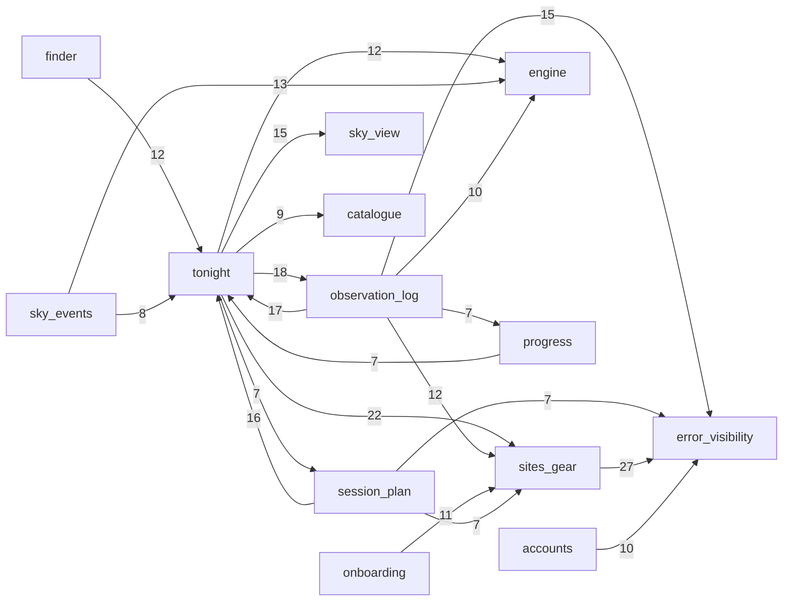

# Repo map: Sidereus

## TL;DR

Sidereus is a web app for beginner amateur astronomers. It tells them whether tonight is worth setting up for (go / marginal / no-go) and ranks Messier and Caldwell objects for their own site and telescope. Around that core it offers a session plan, finder charts, sky events, an observation log with progress badges and an offline copy for the field. It is an Astro 7 SSR app on Cloudflare Workers with Supabase. The product's centre is two capabilities. The pure **sky engine** (`src/lib/engine`) decides the verdict and the ranking. The **Tonight view model** (`src/lib/tonight`) assembles that, the weather forecast, the user's gear, sky checks and the session plan into every Tonight page. The other features plug into Tonight. Activity has been concentrated in Tonight and the design system: together they are 39% of code changes, built in ~15 feature campaigns up to 17–19 Oct. Since then the repo has moved to tests, hooks and e2e setup. Two places need care before a bigger change:
- **the Tonight view model**, the hub every feature edits, which reaches eight capabilities;
- **the ranking and what-to-expect rules**, where the galaxy-brightness rule has taken four attempts and still has an open bug, and every ranked page depends on it.

Every number below comes from a single author working with AI agents: one human, most code written by Claude Code sessions.

Main capabilities and their runtime dependencies. The diagram comes from the structure evidence: runtime file edges ≥ 7 between capabilities. Edges into `shared` are omitted because nearly every capability imports it.

## Terrain

Buzz per family is rated relative to the other capabilities. The families are:
- **chg** — change: activity and trend.
- **fix** — fix pressure after the review-loop demotion. 71 of the 88 `fix` commits are applied impl-review findings, and there are 0 reverts.
- **frc** — friction: open bugs, second attempts, post-merge fixes. Human forge reviews are 0 everywhere, so this family comes from issues and change chains.
- **att** — attention: plans and prose, which track delivery volume.
- **rch** — reach: runtime blast radius.

| Capability | What it does | Crit. (criteria) | chg | fix | frc | att | rch | Trend | Where it lives |
|---|---|---|---|---|---|---|---|---|---|
| **tonight** | `/tonight` dashboard and focused pages: verdict, ranked targets, Moon, planets, seven nights | high (core value; runtime deps on engine, forecast) | **high** (656 changes, 19.4%) | low | med (5 agent REJECT/REVISE, 0 open bugs) | **high** (21 plans; same cause as chg) | **high** (Ca 11; `build.ts` 16 partner caps) | rising to W42, quiet since 17 Oct | `src/lib/tonight`, `src/components/tonight`, `src/pages/tonight*`, `src/lib/targets` |
| **engine** | pure astronomy, scoring, ranking, verdict, what-to-expect | high (core value; 11 caps depend on it) | med (8.8%, the steadiest) | low | **high** (4-change galaxy-rule chain, #178 open, #19 oldest open; #21 was open 24 days and closed 2026-10-19, corrected 2026-10-27) | med-high (8 plans, 3 since 10-15) | **high** (barrel reach 51 files / 18 pages) | constant | `src/lib/engine`, `scripts/*-reference.py` |
| catalogue | Messier/Caldwell/OpenNGC and Hipparcos data, build scripts, licensing | medium (every ranking reads it; ESA licence exposure) | low-med | low | high (shares engine's galaxy chain; ESA answer pending) | med | high (index reach 54 / 28 pages) | W42 spike (star-source-switch) | `src/lib/catalogue`, `scripts/build-*.mjs`, `scripts/lib` |
| observation-log | log entries, seen marks, sky checks | high (user data CRUD) | med-high (8.2%) | low | low (verdict-check → follow-up) | med (6 plans) | med (store reach 28 / 15 pages; two-way with tonight) | peaked W41, fading | `src/lib/observations`, `src/lib/sky-checks`, `src/pages/log`, `src/pages/api/log` |
| sites-gear | sites (map, geolocation), telescopes, eyepieces, gear catalogue | high (user data CRUD; external geocoding/map) | med-high (7.9%) | low | low | med (6 plans) | high* (`gear/store.ts` reach 31 pages; *`GearShell` is the app shell filed here) | seasonal W41, fading | `src/lib/gear`, `src/lib/location`, `src/pages/gear`, `src/pages/api/gear` |
| accounts | sign-up/in, session cookie, middleware, account plans (entitlements) | high (identity, access, entitlement gating, public entry) | med (4.7%) | low | low (0 open issues; audit F3 likely addressed) | med (5 plans) | **high** (`session-user.ts` reach 64 / 45 pages; `account-plan` 28 pages) | constant | `src/middleware.ts`, `src/lib/auth`, `src/lib/account-plan`, `src/pages/auth`, `src/pages/api/auth` |
| session-plan | tonight's editable, saved plan | high (user data; paid feature) | med (99 changes after correction) | low | low | low-med | low (Ca 3; lives inside tonight's view model) | finished 17 Oct | `src/lib/session-plans`, `src/lib/tonight/plan-*`, `src/pages/api/tonight` |
| error-visibility | failure logging, client error endpoint, error shapes | medium (public endpoint; 11 caps depend on it) | med (campaign W42–W43) | low (34% raw, review-driven) | **high** (7 of 9 open issues at 321427c; 6 of 8 since #245 closed #244) | **high** (audit, runbook, 4 of 15 lessons; same cause as frc) | **high** (`log-failure.ts` reach 91 files / 47 pages) | campaign, tail to 20 Oct | `src/lib/observability`, `src/lib/api-errors.ts`, `src/pages/api/client-error.ts` |
| offline | service worker, stored Tonight/finder copies | medium (field use) | low-med | low | med (plan REVISE, 3 critical; flake lessons) | med | med (`copies.ts` reach 27 pages; under every page via `Layout`) | campaign W41–W42, small tail | `src/lib/offline`, `src/sw.ts`, `scripts/build-sw.mjs` |
| sky-view | interactive sky panorama, modes, drag | medium (core value presentation) | med (5 UI changes) | low (33% raw, UI polish) | low | med | low-med (browser code, guarded) | campaign W41–W42 | `src/lib/sky-view`, `src/components/tonight/TonightSky*` |
| forecast | Open-Meteo forecast behind Workers KV | medium (external integration; core value depends on it) | low (1.6%) | low | low | low (1 plan) | low (one importer: `tonight/load.ts`) | constant, low | `src/lib/forecast` |
| finder | star-hopping finder chart (full plan) | medium (core value; entitlement gate) | low (5-day campaign) | low | low (plan REJECTED, resolved) | low | low (leaf consumer) | one-off 13–17 Oct | `src/lib/finder`, `src/components/finder`, `src/lib/engine/finder.ts` |
| progress | checklists, milestone badges | medium (user data) | low | low | low | low | low | one-off 9–17 Oct | `src/lib/progress`, `src/components/progress` |
| onboarding | first site + telescope | medium (gate to signed-in pages) | low | low | low | low | low (Ca 1) | constant, fading | `src/lib/onboarding`, `src/pages/onboarding.astro` |
| sky-events | eclipses, pairings, meteor showers | low (informational) | low (5-day campaign) | low | low (impl REJECTED, resolved) | low | low | one-off 14–17 Oct | `src/lib/engine/{events,meteors,pairings}.ts`, `src/lib/tonight/sky-events.ts` |

Non-business buckets:
- **platform** (CI, `wrangler.jsonc`, agent hooks, test harness, Supabase config): 5.9% of code. It can break deploys, so it is high by what it can break. It is the only code area still moving in W44, and 4 of its 12 fixes are real trial-and-error.
- **shared** (design system, layout, nav, i18n, landing): 19.4% of code. Its activity is the en/pl catalogues and `/design` changing with every feature (mechanical, see below).
- **docs**: touched by 95.9% of commits, because every change ships a plan, reviews and an archive. This is prose and is not ranked.

Coverage: 3,381 code changes; unmapped **0%**; catch-alls `platform` + `shared` **25.3%**; 0 unattributed files at HEAD.

Folders do not match capabilities in these places:
- `src/lib/tonight` holds the session plan's build (`plan-*`), sky-events wording, gear choice and the cross-capability foundations `format.ts` and `tonight-date.ts`.
- `src/lib/targets` is the target-key vocabulary used by the log, plan, ranking and offline.
- `src/lib/engine` holds the finder, events, meteors and pairings logic of three other capabilities.
- `src/components/gear/GearShell.astro` is the shell of every signed-in page.
- `src/lib/observations` holds progress's milestone store.
- Sky checks live under `/log`.

## Real couplings

| Coupling | How we know | Kind |
|---|---|---|
| tonight ⇄ observation-log (18 / 17 runtime file edges; co-change 0.59) | runtime graph + co-change | real: Tonight shows seen marks and the sky-check card; the log reads Tonight's date and format |
| session-plan → tonight (16 edges; co-change **0.85**) | runtime graph + co-change | real: the plan is built inside `TonightView` (`src/lib/tonight/plan-*`, `build.ts`) |
| sky-view + tonight (co-change 0.71), sky-events + tonight (0.65), finder → tonight (12 edges via `tonight/island.ts`) | co-change + runtime graph | real: these features are rendered by and loaded through Tonight's island loader |
| tonight → sites-gear (22), observation-log → sites-gear (12), onboarding → sites-gear (11) | runtime graph | real: `gear/store.ts` is the data-access centre (Ca 23). Part of it is `GearShell`, the app shell filed under gear |
| sites-gear / observation-log / accounts / session-plan → error-visibility (27 / 15 / 10 / 7) | runtime graph | real contract (`log-failure.ts`, `api-errors.ts`), guarded by the silent-catch and no-console tests |
| `api-errors.ts → auth/session-user.ts` | runtime graph (1 edge) | real layering break: the shared error shape depends on accounts, so `session-user.ts` is reachable from 45 pages |
| engine → everything that ranks (barrel Ca 20) | runtime graph | real. The engine imports nothing but `astronomy-engine` (pure, purity-tested) |
| engine + tonight co-change only 0.41 | co-change | open question: engine rule changes often land without a Tonight change (see Risk zones) |
| `src/i18n/messages/en.ts` ⇄ `pl.ts` (123 commits each, 15 partners) | co-change | **mechanical**: lockstep guarded by `satisfies Messages` and the parity test |
| `src/pages/design.astro` (81 commits, Ce 78) | co-change + graph | **mechanical**: dev-only specimen page |
| `engine/parameters.ts` (Ca 32), `utils.ts` (51), `i18n/index.ts` (106) | runtime graph | **mechanical**: config-as-code fan-in |
| migrations ⇄ `database.types.ts` ⇄ `tests/db/tables.ts` | contract (CI drift check per CLAUDE.md) | **mechanical by regeneration**, guarded by CI; not visible in co-change because the types are noise |
| `scripts/*-reference.py` → engine JSON fixtures → reference tests | data coupling | **unknown** to the graph; lockstep not measurable (fixtures excluded as recorded data) |
| `Astro.locals` (Supabase client, user, locale, test clock; 104 files) | none | **unknown**: runtime wiring the import graph cannot see |
| `/_server-islands/*` (9 `server:defer` islands) | code read (Astro route registration, `PROTECTED_ROUTES`); no graph | a second URL surface for every island. It runs through the middleware (`locals.user` is set) but is outside `PROTECTED_ROUTES`, so each loader guards itself (see Watch: accounts) |
| `scripts/build-sw.mjs` bundles `src/sw.ts` by path; worker ⇄ page `store-page` messages | none | **unknown** (runtime contract) |
| `POST /api/client-error` and HTTP routes called by browsers, the worker and `scripts/smoke.mjs` | none | **unknown (external)** |

## Risk zones

### 1. The Tonight view model: the composition root every feature edits

Every product feature adds a block to `TonightView`. Tonight's island loader feeds the finder, session-plan and sky-events pages, so a change here reaches eight capabilities, and it is covered only by e2e and smoke tests.

- **Criticality: high.** It is the core value (PRD US-01..03) and depends at runtime on the engine and the forecast.
- **Signal 1, change (history).** Tonight has the most code changes of any business capability: 656 changes, 19.4% of code (`evidence/1-history.md:15`). `src/lib/tonight/build.ts` is the top hub: 49 commits co-changing with 16 other capabilities, 33 `feat` commits from 24 change ids (`1-history.md:135`). The session plan co-changes with it at 0.85 and sky-view at 0.71 (`1-history.md:112,114`).
- **Signal 2, reach (structure).** Ca 11, with 169 outgoing and 69 incoming cross-capability edges (`evidence/3-structure.md:25`). `src/lib/tonight` is the shared view model for session-plan, sky-events and finder (`3-structure.md:107`). `targets/index.ts` reaches 74 files / 32 pages and `tonight/format.ts` is imported from 8 capabilities (`3-structure.md:75`). The island loaders rely on e2e and smoke (`3-structure.md:118`). The L3 research (2026-10-27) refined this: `island.ts` has no unit test that executes it, but `load.ts` does (`src/lib/tonight/load.test.ts:9` runs the real `loadTonight`). See `context/changes/tonight-request-flow/research.md` §4.2.
- **Independence check.** Attention is also high: 21 primary plans and 316 agent-review findings (`evidence/2-discussion.md:15`). It has the same cause as change (rule 4: Tonight is where features were built), so it is counted once. Change and reach come from different sources (history vs import graph) and do not share a cause.
- **Files:**
  - `src/lib/tonight/build.ts`, `src/lib/tonight/load.ts`, `src/lib/tonight/island.ts`
  - `src/lib/tonight/format.ts`, `src/lib/targets/index.ts`
  - `src/components/tonight/TonightContent.astro`

### 2. The ranking and what-to-expect rules (engine + catalogue data)

The galaxy-brightness and visibility rules have needed repeated second attempts, and one bug is still open. The code is pure and well tested, so the risk is rule correctness, not fragile code. A rule or magnitude change shifts every ranked page, plan and finder chart at once.

- **Criticality: high.** The engine is core value and 11 capabilities depend on it. The catalogue is medium.
- **Signal 1, friction (discussion).** The chain #21 ranking calibration (open 24 days) → #159 M31 at 60 mm → `small-scope-galaxies` → #178 (an open **bug**: OpenNGC V magnitudes too faint for 12 galaxies) → `openngc-galaxy-magnitudes`. The rule took four changes and is still open (`2-discussion.md:40-41`). The oldest open item is #19 (engine fixture `test.todo`s, 32 days). The ESA licence answer for the star data is still pending (`2-discussion.md:41`).
- **Signal 2, reach (structure).** The engine barrel `engine/index.ts` reaches 51 files / 18 pages (`3-structure.md:76`). `catalogue/index.ts` reaches 54 files / 28 pages (`3-structure.md:84`). The `parameters.ts` fan-in (32) is config-as-code and is **not** counted.
- **Independence check.** Change is only medium: steady, 8.8% (`1-history.md:57`). Attention (8 plans) overlaps the friction chain, so it is not counted. Friction comes from issues and change chains, reach from the graph; they are independent.
- **Mitigation (evidence).** The engine imports nothing but `astronomy-engine`, has 23 unit test files and no mocks, and is checked against Skyfield/Stellarium oracles (`3-structure.md:117`).
- **Files:**
  - `src/lib/engine/score.ts`, `ranking.ts`, `expectation.ts`, `contrast.ts`, `parameters.ts`
  - `src/lib/catalogue/index.ts`, `scripts/build-catalogue.mjs`, `scripts/lib/galaxy-colour.mjs`
  - `src/lib/engine/fixtures/expect-reference.ts`, `src/lib/engine/calibration.test.ts`

### Watch (narrowly below the bar)

- **accounts: entitlement and session boundary.** Criticality is high and reach is high:
  - `session-user.ts` is reachable from 45 pages through one layering break in `api-errors.ts`;
  - `account-plan/index.ts` reaches 28 pages (`3-structure.md:80,103`);
  - `/_server-islands/*` is outside `PROTECTED_ROUTES`, so every island loader has to guard itself. The islands do run through the middleware, which sets `locals.user`. What they lack is the protected-path redirect. So each loader checks the user or plan on its own, and the plan is checked twice (in the page shell and again in the island).
    - Evidence: Astro 7.3.2 registers the island route as an ordinary `page` route (`node_modules/astro/dist/core/server-islands/endpoint.js:13-35`), and user middleware runs unless `skipMiddleware` is set (`core/middleware/astro-middleware.js:35-40`). `skipMiddleware` defaults to `false` (`core/fetch/fetch-state.js:115`) and only the error handlers set it.
    - The middleware sets the user at `src/middleware.ts:47` and redirects only on `isProtectedPath` (`src/middleware.ts:55-62`; the list is `src/lib/protected-routes.ts:5-15`, no `/_server-islands`). These anchors are at `2e028e5`; they were `:45` and `:53-59` before #245.
    - Since #245 the middleware is also every island's error boundary (`src/middleware.ts:65-91`): `request.uncaught` and `request.stream` lines carry `route: /_server-islands/<Name>`. That logs an island that breaks; it does not authorise one. The guard rule above is unchanged.
    - The self-guards: `src/lib/finder/load.ts:130` (`requireFullPlan`), `src/lib/session-plans/read.ts:15`, `src/lib/tonight/island.ts:47`.
    - The risk is a new island loader that forgets its own guard.

  Change, friction and attention are only medium. There are 0 open issues (`2-discussion.md:27`). The audit's critical F3, an auth outage that looks like a mass sign-out, sits here (`2-discussion.md:39`). It was likely addressed by `e88e804 feat(error-visibility): Sign-in, session and the finder leave a line (p5)`, but that is an inference from the commit subject and was not verified in the code.
- **error-visibility: open follow-ups.** Criticality is medium. Friction is high: 7 of the 9 open issues at the map's HEAD (6 of 8 after #245 closed #244 on 2026-10-27), including #191 (GDPR of Workers observability data) and #233 (store fault status). It is the only change with fixes after its first merge, and its phase 7 impl review was REJECTED (`2-discussion.md:29,39`). Reach is high: `log-failure.ts` reaches 91 files (`3-structure.md:85`). Attention (the audit, runbook and lessons) has the same cause as friction, the 9-phase campaign (rule 4). That leaves 2 independent families where a medium capability needs 3. Its open items land in other capabilities' files: forecast, tonight, accounts and the save routes.

### Looks hot, is not

- **Fix share everywhere** (error-visibility 34%, sky-view 33%, offline 30%, tonight 27%). 81% of `fix` commits are `fix(<change>): impl review F1–F9`, findings applied before merge. UI polish iterates (rules 5, 12), and there are 0 reverts.
- **`shared` activity and the en/pl catalogues** (123 commits each). These are a translation lockstep guarded by the parity test (rule 3).
- **`src/pages/design.astro`** (81 commits, Ce 78). This is the dev-only kitchen sink.
- **The 15-capability "cycle".** This is an artefact of folding files into capabilities. The only real runtime file cycle is three files inside sky-events (`engine/events.ts` ↔ `meteors.ts` / `pairings.ts`).
- **sites-gear looking load-bearing for every page.** `GearShell.astro`, the app shell, is filed under the gear footprint.
- **Planning volume** (533 prose changes on Tonight's plans). Every change ships a plan (rules 4, 8).
- **Agent-trailer share per capability** (finder 0%, progress 7%). This shows when a capability was built: the trailer share fell from ~87% (W40) to ~13% (W42). It does not show who wrote the code.

## Whom to ask

Single-author baseline: one human, **Rafal Skwara**, authored all 810 non-merge commits. The 184 merges are under the same person's diacritic spelling. Most code came from Claude Code sessions that the owner reviewed and merged. No concentration figure is a finding. The useful second "who" is the written record.

| Zone | Person | Written record to read first |
|---|---|---|
| Tonight view model | Rafal Skwara (owner; 152 commits touching it, 17 Sep – 17 Oct) | `context/archive/*-tonight-dashboard`, `*-adjustable-session-plan`, `*-ui-user-adjustments`, `*-ui-fact-rhythm`; the dated Tonight and Session-plan sections of `CLAUDE.md` |
| Ranking and what-to-expect rules | Rafal Skwara (63 engine commits, 24 Sep – 26 Oct) | `context/archive/*-verified-ephemeris-core` (`tolerance-report.md`), `*-small-scope-galaxies`, `*-openngc-galaxy-magnitudes`, `*-evening-showpieces` (implementation notes), `*-testing-ranking-invariants-and-calibration-oracle`; issues #178, #21, #19 |
| watch: accounts | Rafal Skwara | `*-account-plans`, `*-auth-loose-ends`, `*-testing-access-and-entitlement-boundary`; `context/foundation/lessons.md` ("check the full plan in the island loader") |
| watch: error-visibility | Rafal Skwara | `*-error-visibility` (implementation notes), `context/deployment/error-visibility.md`, `context/audits/observability/` |

No PR has a human forge review (0 of 183). Review happened before each PR, in 126 agent-written plan and impl reviews that the owner triaged. To recover a decision, ask the owner which change id or session produced it, then read that change folder.

## First day

1. `src/middleware.ts`: every request starts here. It resolves the Supabase client, the user and preferences into `Astro.locals` and gates protected routes. Since #245 it is also the boundary for unforeseen throws in every page and island: `request.uncaught` from `next()`, `request.stream` mid-body, each with the route template (`src/middleware.ts:65-91`, `src/lib/observability/stream-guard.ts`).
2. `src/pages/tonight.astro` → `src/components/tonight/TonightContent.astro`: a thin page shell and its `server:defer` island, the product's main screen.
3. `src/lib/tonight/load.ts` and `src/lib/tonight/build.ts`: where Tonight is actually assembled (forecast, gear, plan, sky checks, account plan). This is risk zone 1.
4. `src/lib/engine/index.ts`, then `src/lib/engine/score.ts`, `ranking.ts`, `verdict.ts`, with `parameters.ts` for the tunables: the pure logic behind the verdict and ranking. This is risk zone 2.
5. `src/lib/forecast/service.ts`: the one external data feed the verdict depends on.
6. `src/lib/gear/store.ts`: the load-bearing data access (reached from 31 pages) and the pattern every store follows.
7. `src/lib/account-plan/index.ts`: the entitlement gate (`requireFullPlan`) for the finder, session-plan edits and what-to-expect.
8. `src/lib/observability/log-failure.ts`: how every failure is logged (reached from 91 files), and the tripwires around it.

## Limitations

- **Window.** The window is the whole history, only ~6 weeks (2026-09-15..2026-10-27, ~1,000 commits). Trends are weekly and short. Whether the features that went quiet after 19 Oct are finished or paused is unknown. PR #245 (stream-error-boundary) merged after the map's HEAD `321427c`. The branch now sits on its merge `2e028e5`, but no metric was recomputed. #245 changes 7 files outside `context/` (the middleware, `log-failure.ts`, `stream-guard.ts`, their tests and `CLAUDE.md`). Inference: recomputing would shift the error-visibility and accounts counts slightly and no ranking.
- **Sources.** git, `gh` (read-only: 183 PRs, 62 issues) and the planning artefacts. No production error data was available: logs are first-party only and an external tracker is parked. Post-merge defect rates are therefore unknown.
- **One human, many agents.** All concentration statistics are a baseline. Authorship cannot separate human from agent work: 297 of 810 commits carry a Claude trailer, which is a lower bound because trailers stopped being added from ~W41. No human code review is recorded on the forge, and whether diffs are read before merging is not observable.
- **Commit types are workflow labels.** `fix` mostly marks applied review findings, so fix pressure is a weak signal here. Friction relies on issues, change chains and agent review verdicts instead.
- **Graph coverage.**
  - TS/TSX/Astro: level 2, the project's own compiler API, high confidence for static edges.
  - The lesson's tool, dependency-cruiser, is not installed and was not installed. `.astro` files would need a custom extractor anyway.
  - Python: level 4. No graph for SQL/RLS/RPCs, CI, `wrangler.jsonc`, `Astro.locals` wiring, server-island URLs or the service-worker build.
  - To get the locked compiler, `npm ci --ignore-scripts` was run in the worktree (`node_modules`, git-ignored).
- **Capability coverage.** Unmapped 0%; catch-alls 25.3% of code. Three known attribution errors were reported but not corrected, to keep one scheme across agents:
  - the glob `src/components/tonight/Plan*` also catches the Planet components, inflating session-plan by 25 changes (true figure ~99 changes / 26 commits);
  - `GearShell.astro` (the app shell) is counted as sites-gear;
  - `Welcome.astro` (the landing page) is counted as onboarding.

  The change-id → capability mapping and the issue → capability mapping are inferences.
- **What the map does NOT say.** It does not say whether the code is correct, how fast it runs, or how users actually use it. Criticality comes from fixed criteria, not from traffic or revenue: there is no payment flow, and payments are parked.
- **Unknowns worth a focused investigation:**
  - whether an engine rule change can silently misstate Tonight wording (engine + tonight co-change is only 0.41);
  - the server-island surface (`/_server-islands/*`): it is outside `PROTECTED_ROUTES`, so whether every island loader guards itself (user and plan) is checked per loader, not by one rule;
  - the data lockstep between the Python oracles, the engine fixtures and the reference tests;
  - the runtime reach of `Astro.locals` and the Supabase RPCs (`record_sky_verdict`, `complete_onboarding`) and RLS;
  - the open error-visibility follow-ups (#191 GDPR of Workers traces, #233 store fault status; #244 stream errors was closed by #245 on 2026-10-27, and its user-facing side, the island fallback, stays open as #190);
  - the forecast dependency: core value, yet the least discussed integration (1 plan), with audit finding F1 about outages.
- **Other unknowns from the evidence:**
  - Cloudflare bindings (KV, rate limit) and `astro:env` are virtual modules, so their edges are dropped.
  - The service worker's page list may drift from Tonight's page list (`TONIGHT_PAGES` / `TONIGHT_NAV`); co-change is only 0.61.
  - Whether the size of `build.ts` is itself a maintainability problem: file size was not measured.
  - Owner checks kept in `context/handoff.md` (manual S-07 checks, iPhone Safari, ESA and IAU MDC answers) are not issues and are not counted.
  - Future contributors, the true agent-written share and Claude session identities are unknown.
  - Dropped: the in-flight `context/changes/ui-refine` title-matching artefact (two PRs counted twice). It does not change any ranking.
